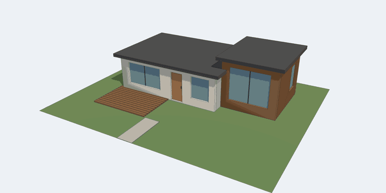
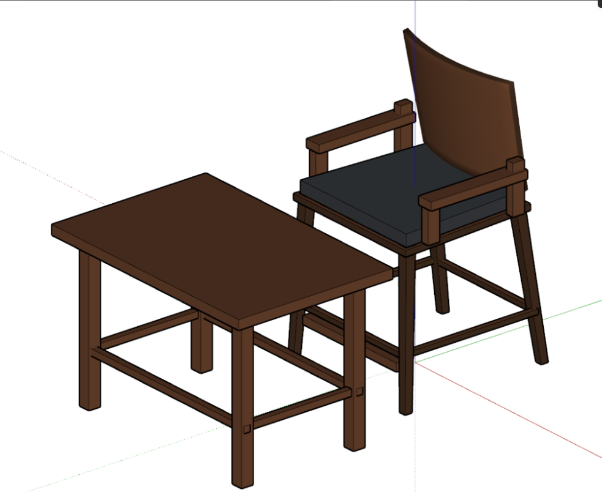
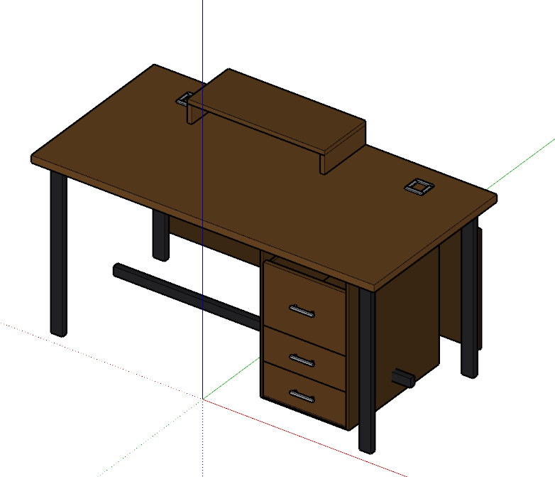
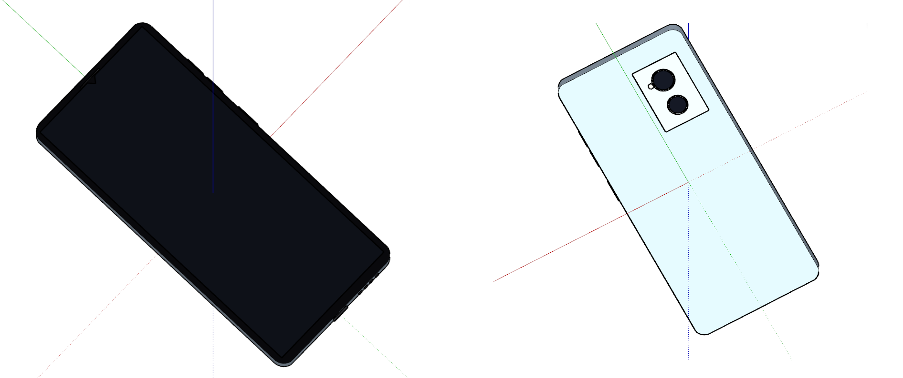

<div align="center">


# OpenSKP

**Read, write and convert SketchUp `.skp` files. No SketchUp, no SDK, no license key.**

Python · TypeScript · .NET · Dart · C++ · Rust

[](https://pypi.org/project/openskp/)
[](https://www.npmjs.com/package/openskp)
[](https://www.nuget.org/packages/OpenSkp)
[](https://pub.dev/packages/openskp)
[](https://github.com/iamahsanmehmood/openskp/releases?q=cpp-)
[](https://opensource.org/licenses/MIT)
<br>
[](https://pepy.tech/projects/openskp)
[](https://www.npmjs.com/package/openskp)
[](https://github.com/iamahsanmehmood/openskp/graphs/contributors)
[](https://github.com/iamahsanmehmood/openskp)

### [Try it in your browser](https://iamahsanmehmood.github.io/openskp/) · [Documentation](https://iamahsanmehmood.github.io/openskp/docs/) · [openskp.com](https://openskp.com) · [Discussions](https://github.com/iamahsanmehmood/openskp/discussions)



<sub>[modern_house.skp](examples/web-viewer/samples/modern_house.skp): written with [a Python script](examples/web-viewer/samples/make_modern_house.py), read and converted to GLB by OpenSKP, without SketchUp.</sub>

</div>

```bash
pip install openskp
```

```python
from openskp import SkpFile
from openskp.export import glb

skp = SkpFile.open("house.skp")
model = skp.parse()                  # layers, components, faces, materials, scenes ...
glb.export(skp, "house.glb")         # ... or OBJ, STL, PLY, DXF, IFC4 and JSON
```

The same in [TypeScript](#-typescript--javascript), [.NET](#-net--c), [Dart](#-dart--flutter), [C++](#%EF%B8%8F-c17--cmake) and [Rust](packages/rust/README.md).

<div align="center">

**⭐ If OpenSKP is useful to you, please [give it a star](https://github.com/iamahsanmehmood/openskp). It helps others find it.**

**Want to help?** Start with a [good first issue](https://github.com/iamahsanmehmood/openskp/issues?q=is%3Aissue+is%3Aopen+label%3A%22good+first+issue%22), or ask in [Discussions](https://github.com/iamahsanmehmood/openskp/discussions).

[Quick Start](#-quick-start) · [Features](#-features) · [Built by AI](#-built-by-ai-too) · [Featured](#-featured) · [Used in Production](#-used-in-production) · [Built with OpenSKP](#-built-with-openskp) · [Documentation](#-documentation) · [Contributing](#-contributing)

</div>

---

## 🌟 What is OpenSKP?

OpenSKP is an open-source toolkit for SketchUp (`.skp`) files, built entirely through reverse engineering. Each language has its own native implementation, not a binding around a shared core.

- **Read** SketchUp 2021+ files and the classic ones from SketchUp 4 to 2020 ([known exceptions](docs/LANGUAGE_PARITY.md#4-real-sketchup-file-version-support)): geometry, materials and textures, components, tags, scenes, dimensions and attributes.
- **Write** real, editable models from scratch, or extend an existing file with `open_existing()`. Files are saved in the SketchUp 2017 format. See [Write capabilities](docs/DEVELOPER_GUIDE.md#write-capabilities) and [how each writer is checked](docs/LANGUAGE_PARITY.md#writer-validation).
- **Convert** to GLB, OBJ, STL, PLY, DXF, IFC4 and JSON without a CAD or BIM SDK; also to and from Fragments (`.frag`). See [Export capabilities](docs/DEVELOPER_GUIDE.md#export-capabilities).
- **Generate code** that rebuilds a model, for example as a start for an AI coding agent or to compare two models as text. See [Generating code from a file](docs/DEVELOPER_GUIDE.md#generating-code-from-a-file).

Python, TypeScript, .NET, Dart and C++ are published packages; Rust is on `main` and not on crates.io yet. Not every feature is in every language: see the [feature table](#-feature-support-by-language).

> [!IMPORTANT]
> This project was built by reverse engineering a proprietary binary format. It is not affiliated with or endorsed by Trimble Inc. or SketchUp.

---

## ✨ Features

| Feature | Status | Description |
|:--------|:------:|:------------|
| **Parse SKP 2021+ (VFF)** | ✅ | Full support for the modern VFF binary container |
| **Parse classic SKP 4–2020 (MFC)** | ✅ | Classic MFC `CArchive` container — same output shape as VFF. SketchUp 4–2020 are supported, with known gaps on real V3 and wild V5 files — see [docs/LANGUAGE_PARITY.md § 4](docs/LANGUAGE_PARITY.md#4-real-sketchup-file-version-support) |
| **3D Geometry Extraction** | ✅ | Vertices, edges, faces, normals, and UV coordinates |
| **Component Hierarchy** | ✅ | Nested component definitions and instance transforms |
| **Scene Baking / Triangulation** | ✅ | Opt-in scene baking: full placed scene graph resolved to world-space, triangulated, GLB-ready — in all five languages |
| **Layers / Tags** | ✅ | Layer definitions with colors and visibility (`hidden` state) — fully exposed across all five languages |
| **Materials & Textures** | ✅ | Material properties, colors, transparency, colorized materials, and embedded texture images |
| **Styles** | ✅ | `styles[].front_color`/`back_color` (2021+) and the model's face colours `face_front_color`/`face_back_color` (SketchUp 4–2025) in all five languages; scenes show unpainted faces in those colours ([#533](https://github.com/iamahsanmehmood/openskp/issues/533)) |
| **Dynamic Components** | 🔶 | Instance and face attribute dictionaries extracted in all five languages (2021+ and pre-2021); **definition- and model-level** attribute dictionaries (Dynamic Components formulas/options) are complete in Python only, see [the table](docs/LANGUAGE_PARITY.md#2-feature-matrix) |
| **Observability** | ✅ | Opt-in progress reporting + structured, location-carrying parse errors — see [docs/OBSERVABILITY.md](docs/OBSERVABILITY.md) |
| **Convert to GLB / OBJ / STL / PLY / DXF 3D / IFC4 / JSON** | ✅ | Native, from-scratch conversion to glTF (GLB), Wavefront OBJ, STL, PLY, DXF 3D (AutoCAD Polyface Mesh), IFC4 (BIM), and JSON metadata — available in all five languages, no third-party CAD/BIM SDK involved — see [Export capabilities](docs/DEVELOPER_GUIDE.md#export-capabilities) |
| **Convert to Fragments (.frag)** | ✅ | Direct SketchUp → [ThatOpen Fragments](https://github.com/ThatOpen/engine_fragment) export for BIM web viewers, no IFC intermediate. Published in Python (`openskp[fragments]`), TypeScript, .NET (`OpenSkp.Fragments`), and C++; on `main` (not published to pub.dev) in Dart (`openskp_fragments`). See [docs/LANGUAGE_PARITY.md § Fragments](docs/LANGUAGE_PARITY.md#fragments-frag-support) and [Fragments export](docs/DEVELOPER_GUIDE.md#fragments-export) |
| **Read a Fragments (.frag) file back** | ✅ | Parses `.frag` `SHELL` geometry into an `InstancedScene` (`CIRCLE_EXTRUSION` samples are skipped with a warning). Python is verified on a real ThatOpen `IfcImporter` file as well as OpenSKP output; TypeScript, .NET, Dart (on `main`, not published), and C++ are verified on OpenSKP round-trips. See [docs/LANGUAGE_PARITY.md § Fragments](docs/LANGUAGE_PARITY.md#fragments-frag-support) and [Reading a .frag file back](docs/DEVELOPER_GUIDE.md#reading-a-frag-file-back) |
| **Write native `.skp` files** | ✅ | Build new `.skp` files from scratch — geometry (including genuine circular/arc curves, freeform polylines, faces with holes cut out, and non-planar auto-triangulation), solid/textured materials, layers, nested component definitions and groups, instance rotation/visibility, and custom attribute dictionaries. No SDK at runtime — Python and C++ are checked against SketchUp's C library, while TypeScript, .NET, and Dart are checked byte-for-byte against Python in CI. See [Writer validation](docs/LANGUAGE_PARITY.md#writer-validation) and [Write capabilities](docs/DEVELOPER_GUIDE.md#write-capabilities) |
| **Edit existing `.skp` files** | ✅ | Load an existing legacy-format file and extend it — reuses its materials, layers, and component definitions, adds new geometry or instances, and saves a new file. All five languages. See [Editing an existing file](docs/DEVELOPER_GUIDE.md#editing-an-existing-file) |
| **Generate rebuild code from a file** | ✅ | Turn a parsed `.skp` file into a human-readable, re-runnable source-code transcript that calls the same language's own writer API to rebuild it — materials, textures, layers, nested definitions, holes, instance-level paint and names. All five languages. See [Generating code from a file](docs/DEVELOPER_GUIDE.md#generating-code-from-a-file) |
| **AI coding-agent ready** | ✅ | A generic, well-documented writer API (no object-specific helpers needed) that AI coding agents can compose freely — proven on five generated models across two AI coding agents (the three pictured screenshots come from one agent, Antigravity, while screenshots for the first agent's chair and house models are pending), each built from a natural-language or reference-photo prompt with no primitives library involved. See [AI-Generated Models](docs/AI_MODELING.md) |
| **Streaming / low-memory parsing** | ✅ | Lazy top-level TLV walk bounds walk memory per definition in Python, TypeScript, and C++ (`.NET`/Dart unwrap `F401` only, and TypeScript's materialized `SkpModel` hits V8 heap limits on ~300 MB files) — see [Memory architecture](docs/ARCHITECTURE.md#memory-architecture) and [Performance](docs/DEVELOPER_GUIDE.md#performance) |
| **No SketchUp SDK** | ✅ | No SketchUp install or license required. TypeScript, .NET, Dart, and Rust use no native dependencies; C++ builds `miniz`, `TinyGLTF`, and `FlatBuffers` headers privately via CMake; Python requires `numpy`, `shapely`, `mapbox_earcut` (prebuilt native wheels), `trimesh`, and `defusedxml` |
| **Cross-Platform** | ✅ | Works on Linux, macOS, and Windows |

---

## 📺 Featured

OpenSKP and its Blender and FreeCAD add-ons have been covered by [Blender 3D Architect](https://www.youtube.com/@blender3darchitect), a YouTube channel about Blender for architecture:

<table>
<tr>
<td align="center" width="50%">
<a href="https://www.youtube.com/watch?v=q-Gjsa4tuPU"></a><br>
<b>Blender and FreeCAD Can Now Read and Write SketchUp Files</b><br>
<sub>Blender 3D Architect · October 2026</sub>
</td>
<td align="center" width="50%">
<a href="https://www.youtube.com/watch?v=M43s__dC3FM"></a><br>
<b>Blender 5.3 Just Made Importing SketchUp Files Easier Than Ever</b><br>
<sub>Blender 3D Architect · November 2026</sub>
</td>
</tr>
</table>

Also mentioned in:

- **Blender 3D Architect:** [BIMCraft Just Broke Revit's File Lock-In](https://www.youtube.com/watch?v=0uX-DMzZo10), which compares BIMCraft to "the same kind of breakthrough that OpenSKP brought to the SketchUp world"
- **Hacker News:** the front-page thread on [KetchUp, an open-source SketchUp alternative](https://news.ycombinator.com/item?id=50418176), where a commenter notes it reads SketchUp files with OpenSKP
- **Digital Production:** [IngeTrazo: A Home for the Render Farm](https://digitalproduction.com/2026/10/08/ingetrazo-open-source-architectural-modelling/), covering IngeTrazo's `.skp` import through OpenSKP

---

## 🏭 Used in Production

OpenSKP isn't just a library — it's the SketchUp-parsing engine behind real, actively-used production applications:

| Project | Description | How it uses OpenSKP |
|:--------|:-------------|:---------------------|
|  [FrameSmart](https://frame-smart.com/) | A 3D collaboration platform for viewing, sharing, and collaborating on 3D models together with their metadata (IFC, SketchUp, and more) — hosted on Linux. | Powers FrameSmart's entire SketchUp import pipeline, end to end. |
| [IngeTrazo](https://ingetrazo.com/) | A free, Linux-first 3D modeler for civil engineering and architecture — a SketchUp alternative with a BIM → IFC bridge. | Replaced IngeTrazo's Wine + proprietary SketchUp DLL dependency as its native `.skp` import backend. |
| <picture><source media="(prefers-color-scheme: dark)" srcset="assets/users/rayscaper-dark.svg" /></picture> [Rayscaper](https://rayscaper.com/) | A photorealistic render plugin for SketchUp that updates live as you model. | Reads `.skp` models through OpenSKP. |
| <picture><source media="(prefers-color-scheme: dark)" srcset="assets/users/modlumi-dark.svg" /></picture> [Modlumi](https://modlumi.com/) | A practical 3D modeling app for independent designers and craftspeople, on Windows and in the browser. | Opens and imports existing `.skp` models through OpenSKP. |
| [Sawhorse](https://sawhorse3d.com/) | A free, local-first, SketchUp-style push/pull modeler for woodworkers and makers, in the browser and on the desktop. | Opens `.skp` files through the `openskp` npm package. |

Using OpenSKP in your own project? [Open an issue](https://github.com/iamahsanmehmood/openskp/issues) or a PR to add it here.

---

## 🌍 Built with OpenSKP

Beyond the production apps above, other developers have built OpenSKP into their own software. These are the public projects we could find on GitHub in November 2026; each one names OpenSKP in its code, notices or docs.

### Apps that open or save `.skp` through OpenSKP

| Project | What it is | How it uses OpenSKP |
|:--------|:-----------|:--------------------|
| [Rodeo](https://rodeo.build) | Free, open-source drawing and 3D modelling in the browser | Opens `.skp` files and saves the 3D model as `.skp` with the npm package (reader and writer) |
| [Hestia BIM](https://www.hestiabim.com) | Browser-based BIM for residential architecture | Imports SketchUp furniture with the npm package |
| [Serpentine3D](https://github.com/chisomobanzi/Serpentine3D) | Open-source NURBS surface modeller on OpenCASCADE | Imports `.skp` on Linux, Windows and Mac with the Python package |
| [ToonStudio](https://www.toonstudio.cloud/) | Webtoon and web-novel creation platform | Imports SketchUp models as 3D backgrounds with the npm package |
| [DeepDraw](https://github.com/lihang185/deepdraw) | Lightweight SketchUp alternative from China ([archieast.com](http://www.archieast.com)) | Its `.skp` import is the OpenSKP C++ library, built in through pybind11 |
| [PushForm](https://github.com/PushForm/pushform-app) | 2D/3D push/pull modeller for carpenters, architects and landscapers | Depends on the npm package for `.skp` files |
| [Arch3D](https://dsalesarchitect.github.io/arch3d/) | Lightweight BIM authoring in Rust and OpenGL | Reads `.skp` meshes through OpenSKP |
| [SketchyUp](https://github.com/zygote55/sketchyup) | Native Linux 3D modeller (C++20, Qt 6) | Bundles a pinned copy of OpenSKP for `.skp` import |
| [Workbench3D](https://github.com/drakeg/workbench3d) | 3D modeller | Depends on the npm package |
| [ARCA](https://github.com/enygma-id/arca) | BIM-to-GIS converter (GeoJSON, GLB, CityJSON, CityGML) | Converts SketchUp models through an OpenSKP adapter |
| [acoustic-spaces](https://github.com/naelolaiz/acoustic-spaces) | Room-acoustics simulation research | Reads the SketchUp room models of an acoustics dataset |
| [sketchup-to-pdf-converter](https://helggaa.github.io/sketchup-to-pdf-converter/) | Browser `.skp` viewer and PDF exporter | Built with React, Three.js and OpenSKP |

### Readers ported from OpenSKP or checked against it

| Project | What it is | Link to OpenSKP |
|:--------|:-----------|:----------------|
| [ConstructCraft](https://constructcraft.net) | Open-source BIM authoring in Rust | Its `.skp` reader and writer are a Rust port of OpenSKP |
| [Curiosity XRay.3D](https://github.com/curiosity-ai/x-ray-others) | 3D file reading for Curiosity's search platform | Its C# SketchUp reader follows OpenSKP's record layout, credited in its third-party notices |
| [TeamCraft](https://warr-ev.github.io/TeamCraft/) | Open-source PDM/PLM in Rust | Vendors a Rust port of OpenSKP for SketchUp previews |
| [Hoard](https://azazel-labs.github.io/Hoard/) | Game asset manager | Reads `.skp` with a Rust port of OpenSKP |
| [ModelCraft](https://getcadcraft.com/apps/modelcraft) | Push/pull 3D modelling (CadCraft suite) | Its own reader, checked against OpenSKP's npm package |
| [CivilKit CAD](https://civilkit.io/cad/) | B-rep CAD kernel in Rust and WebAssembly | Its `.skp` reader is checked against OpenSKP's output |
| [skp2ifc](https://github.com/MTPython406/skp2ifc) | SketchUp to IFC4 converter in Python | Its reader is derived from OpenSKP |

### Add-ons by other developers

| Add-on | For | What it does |
|:-------|:----|:-------------|
| [SketchUp Imparator](https://github.com/gurkanerol/sketchup-imparator) | Blender | Native `.skp` importer with OpenSKP bundled inside |
| [freecad_sketchup_plugin](https://github.com/djbarrow/freecad_sketchup_plugin) | FreeCAD | Opens `.skp` models with groups, components, colours and tags |
| [ingetrazo-skp-dc-import](https://github.com/moominot/ingetrazo-skp-dc-import) | IngeTrazo | Imports SketchUp dynamic components |

### Listed in

[awesome-reverse-engineered](https://github.com/alexgaoth/awesome-reverse-engineered) · [3d-resources](https://github.com/devanshutak25/3d-resources) · [Awesome-AECO](https://github.com/osama-ata/Awesome-AECO) · [awesome-digital-built-environment](https://github.com/Z-Arghavan/awesome-digital-built-environment) · the [OSArch](https://osarch.org) software list

Built something with OpenSKP that isn't here? [Open an issue](https://github.com/iamahsanmehmood/openskp/issues) or a PR to add it.

---

## 🧩 CAD/DCC Integrations

Native `.skp` import/export for other tools, built on this project — no
Trimble SDK, no SketchUp install:

| Addon | Status | Repo |
|:------|:-------|:-----|
| **FreeCAD** | Import + export, real B-rep geometry (not a triangulated mesh), with the component hierarchy, colours and tags. Textures not yet carried over. | [freecad-openskp](https://github.com/iamahsanmehmood/freecad-openskp) |
| **Blender** | Import + export, collection-instancing architecture (a component placed 1,000 times costs one mesh, not 1,000). Materials, textures and tags on import; colours and tags on export. | [blender-openskp](https://github.com/iamahsanmehmood/blender-openskp) · [Blender Extensions](https://extensions.blender.org/add-ons/openskp-import-export/) |

Both are early and under active development — real bugs get found and
fixed by testing against real files, not by waiting until everything's
perfect. Try them, and open an issue on the addon's own repo (not here)
for anything specific to FreeCAD/Blender behavior.

---

## 🖥️ Platform Support

| Platform | Version | Status | Install |
|:---------|:--------|:------:|:--------|
| 🐍 **Python** | [](https://pypi.org/project/openskp/) | ✅ Available | `pip install openskp` |
| 📘 **TypeScript / JS** | [](https://www.npmjs.com/package/openskp) | ✅ Available | `npm install openskp` |
| 🚀 **.NET / C#** | [](https://www.nuget.org/packages/OpenSkp) | ✅ Available | `dotnet add package OpenSkp` |
| 🎯 **Dart / Flutter** | [](https://pub.dev/packages/openskp) | ✅ Available | `dart pub add openskp` |
| ⚙️ **C++17** | [](https://github.com/iamahsanmehmood/openskp/releases?q=cpp-) | ✅ Source package | `find_package(OpenSkp CONFIG REQUIRED)` |

All five languages are on **1.7.0** as of the 2026-11-25 synchronized
release. The version number is the same, the capability nearly so: Python alone
writes scenes (`add_scene`), and a few smaller differences are listed below. All five parse both the modern VFF (2021+)
and classic MFC (SketchUp 4–2020) `.skp` containers, and support the same
opt-in scene-baking (`buildScene()`) and observability APIs. Full detail
on what differs between languages, and which real SketchUp file versions
actually parse today, is in the section right below.

---

## 🔀 Feature Support by Language

Every feature, across all 5 languages — ✅ shipped & released, ❌ not yet
ported. Full detail (including `n/a`/"not independently checked" nuance)
in **[docs/LANGUAGE_PARITY.md](docs/LANGUAGE_PARITY.md)** — this is the
condensed version.

| Feature | Python | TypeScript | .NET | Dart | C++ |
|:---|:---:|:---:|:---:|:---:|:---:|
| Parse VFF (2021+) & classic MFC (SketchUp 4–2020; [§4](docs/LANGUAGE_PARITY.md#4-real-sketchup-file-version-support)) | ✅ | ✅ | ✅ | ✅ | ✅ |
| Geometry, layers, materials/textures | ✅ | ✅ | ✅ | ✅ | ✅ |
| Styles and the model's face colours (`face_front_color`/`face_back_color`), used in scenes | ✅ | ✅ | ✅ | ✅ | ✅ |
| Dynamic Components / attribute dicts (instance/face in all 5; definition and model dicts complete in Python) | ✅ | 🔶 | 🔶 | 🔶 | 🔶 |
| Attribute dicts: multi-dictionary + typed values (`Point3d`/`Length`/nested lists; 9/9 classic and VFF) | ✅ | ✅ | ✅ | ✅ | ✅ |
| Attribute dicts surfaced in GLB/JSON metadata export (not just IFC Psets) | ✅ | ❌ | ❌ | ❌ | ✅ JSON |
| VFF pages/scenes + dimension parsing | ✅ | ✅ | ✅ | ✅ | ✅ |
| Legacy (pre-2021) pages/scenes reading | ✅ with cameras (2014–2020) | ✅ | ✅ | ✅ | ✅ |
| Construction lines/points reading | ✅ legacy + VFF | ✅ | ✅ | ✅ | ✅ legacy + VFF |
| Scene baking, instancing-preserving scene output | ✅ | ✅ | ✅ | ✅ | ✅ |
| Loose-edge curve support (structural framing) | ✅ | ✅ | ✅ | ✅ | ✅ |
| Writer: materials/layers/definitions/groups/faces/curves/images | ✅ | ✅ | ✅ | ✅ | ✅ |
| Writer: dimensions, section planes, construction geometry | ✅ | ✅ | ✅ | ✅ | ✅ |
| Writer: scenes (camera + hidden layers) | ✅ | ❌ | ❌ | ❌ | ❌ |
| Editor (`open_existing()`), code generator | ✅ | ✅ | ✅ | ✅ | ✅ |
| Export: GLB / OBJ / STL / PLY / DXF / IFC4 / JSON | ✅ | ✅ | ✅ | ✅ | ✅ |
| IFC export correctness fixes (units, layer visibility, Psets, classification) | ✅ | ✅ | ✅ | ✅ | ✅ |
| IFC curve/arc annotations (`IfcAnnotation`/`IfcArcIndex`) | ✅ | ✅ | ✅ | ✅ | ✅ |
| **Fragments (`.frag`) export** ([details](docs/LANGUAGE_PARITY.md#fragments-frag-support)) | ✅ | ✅ | ✅ | 🔶 on `main`, not published | ✅ |
| **Fragments (`.frag`) import** ([details](docs/LANGUAGE_PARITY.md#fragments-frag-support)) | ✅ | ✅ | ✅ | 🔶 on `main`, not published | ✅ |

### Real SketchUp file version support

Classic MFC files from **SketchUp 4 through 2020** and modern VFF files from **SketchUp 2021+** are read across all five languages, with known exceptions (real SketchUp 3 files fail in every reader; a real SketchUp 5 file in the wild fails in TypeScript). For writing, `create()` and `open_existing()` emit a **SketchUp 2017** (`{17.0.1}`) classic MFC scaffold (`blank_v17.skp`) that SketchUp 2017 and newer open natively.

Full per-version, per-language status table and evidence (synthetic fixtures, SDK-written files, and the real-world multi-version sweep): **[docs/LANGUAGE_PARITY.md § 4](docs/LANGUAGE_PARITY.md#4-real-sketchup-file-version-support)**.

---

## 🚀 Quick Start

Pick your language — every sample below runs against the current public
API (verified while writing this README). For the full picture (the
opt-in `buildScene()` step for triangulated meshes, memory/performance
guidance, progress + error observability, legacy-format support, and the
full writer/editor API), see the
**[Developer Guide](docs/DEVELOPER_GUIDE.md)**.

### 🐍 Python

```bash
pip install openskp
```

```python
from openskp import SkpFile

model = SkpFile.open("my_model.skp").parse()

print(f"SketchUp version: {model.version}")
print(f"Layers: {[l.name for l in model.layers]}")

for def_id, defn in model.definitions.items():
    print(f"{defn.name}: {len(defn.vertices)} verts, {len(defn.faces)} faces")

for material in model.materials:
    print(f"Material: {material.name}", "(has texture)" if material.texture else "")

# Opt-in: full placed scene graph, triangulated, world-space, GLB-ready
scene = SkpFile.open("my_model.skp").build_scene()
print(f"{len(scene.glb_primitives)} renderable mesh primitives")
```

**Writing:**

```python
from openskp import create

builder = create()
red = builder.add_material("Red", (255, 0, 0))
with builder.add_component_definition("Chair") as chair:
    chair.add_face([(0, 0, 0), (20, 0, 0), (20, 20, 0), (0, 20, 0)])
builder.add_instance(chair, translation=(50, 0, 0))
builder.add_instance(chair, translation=(100, 0, 0), hidden=True)
builder.add_face([(0, 0, 0), (100, 0, 0), (100, 100, 0), (0, 100, 0)], material=red)
builder.save("output.skp")
```

And to extend a file that already exists rather than starting from
scratch, use `open_existing()` — see
[Editing an existing file](docs/DEVELOPER_GUIDE.md#editing-an-existing-file)
in the Developer Guide.

### 📘 TypeScript / JavaScript

```bash
npm install openskp
```

```typescript
import { SkpFile, toGLB } from 'openskp';

// Node.js
const model = SkpFile.open('my_model.skp').parse();

// Browser (isomorphic - same package, no Node APIs)
// const buffer = await fetch('my_model.skp').then(r => r.arrayBuffer());
// const model = parseSkp(buffer);

console.log(model.version, model.layers);

// Opt-in: full placed scene graph, triangulated, world-space, GLB-ready
const scene = SkpFile.open('my_model.skp').buildScene();
const glb = toGLB(scene);   // ready to write to a .glb file
```

**Writing:**

```typescript
import { create } from 'openskp';

const builder = create();
const red = builder.addMaterial('Red', [255, 0, 0]);
const chair = builder.addComponentDefinition('Chair', (def) => {
  def.addFace([[0, 0, 0], [20, 0, 0], [20, 20, 0], [0, 20, 0]]);
});
builder.addInstance(chair, { translation: [50, 0, 0] });
builder.addInstance(chair, { translation: [100, 0, 0], hidden: true });
builder.addFace([[0, 0, 0], [100, 0, 0], [100, 100, 0], [0, 100, 0]], { material: red });
builder.save('output.skp');   // Node.js; use builder.toBytes() in the browser
```

### 🚀 .NET / C#

```bash
dotnet add package OpenSkp
```

```csharp
using OpenSkp;

var model = SkpFile.Open("my_model.skp");
Console.WriteLine($"{model.Version} - {model.Layers.Count} layers");

// Opt-in: full placed scene graph, triangulated, world-space, GLB-ready
var scene = SkpFile.BuildScene("my_model.skp");
Console.WriteLine($"{scene.GlbPrimitives.Count} renderable mesh primitives");

var glb = GlbExport.ToGlb(scene);       // ready to write to a .glb file
GlbExport.ExportGlb(scene, "my_model.glb");
IfcExport.ExportIfc(scene, "my_model.ifc");
```

**Writing:**

```csharp
var builder = SkpCreate.NewFile();
int red = builder.AddMaterial("Red", (255, 0, 0));
var chair = builder.AddComponentDefinition("Chair");
using (chair)
{
    chair.AddFace(new (double, double, double)[] { (0, 0, 0), (20, 0, 0), (20, 20, 0), (0, 20, 0) });
}
builder.AddInstance(chair, translation: (50, 0, 0));
builder.AddInstance(chair, translation: (100, 0, 0), hidden: true);
builder.AddFace(new (double, double, double)[] { (0, 0, 0), (100, 0, 0), (100, 100, 0), (0, 100, 0) }, material: red);
builder.Save("output.skp");
```

### 🎯 Dart / Flutter

```bash
dart pub add openskp
```

```dart
import 'package:openskp/openskp.dart';

final model = SkpFile.open('my_model.skp').parse();
print('${model.version} - ${model.layers.length} layers');

// Opt-in: full placed scene graph, triangulated, world-space, GLB-ready
final scene = SkpFile.open('my_model.skp').buildScene();
print('${scene.glbPrimitives.length} renderable mesh primitives');

final glb = toGlb(scene);               // ready to write to a .glb file
exportGlb(scene, 'my_model.glb');
exportIfc(scene, 'my_model.ifc');
```

**Writing:**

```dart
final builder = create();
final red = builder.addMaterial('Red', [255, 0, 0]);
final chair = builder.addComponentDefinition('Chair', (def) {
  def.addFace([(0.0, 0.0, 0.0), (20.0, 0.0, 0.0), (20.0, 20.0, 0.0), (0.0, 20.0, 0.0)]);
});
builder.addInstance(chair, translation: (50.0, 0.0, 0.0));
builder.addInstance(chair, translation: (100.0, 0.0, 0.0), hidden: true);
builder.addFace([(0.0, 0.0, 0.0), (100.0, 0.0, 0.0), (100.0, 100.0, 0.0), (0.0, 100.0, 0.0)], material: red);
builder.save('output.skp');
```

### ⚙️ C++17 / CMake

```cmake
find_package(OpenSkp CONFIG REQUIRED)
target_link_libraries(your_target PRIVATE OpenSkp::OpenSkp)
```

```cpp
#include <openskp/openskp.hpp>

auto skp = openskp::SkpFile::open("my_model.skp");
auto model = skp.parse();
auto scene = skp.build_scene();
auto glb = openskp::to_glb(scene);
openskp::export_glb(scene, "my_model.glb");
openskp::export_ifc(scene, "my_model.ifc");
```

**Writing:**

```cpp
using namespace openskp;

auto builder = create();
int red = builder->add_material("Red", Color3{255, 0, 0});
auto& chair = builder->add_component_definition("Chair");
chair.add_face({{0, 0, 0}, {20, 0, 0}, {20, 20, 0}, {0, 20, 0}});
chair.close();

InstanceOptions opts1;
opts1.translation = {50, 0, 0};
builder->add_instance(chair, opts1);

InstanceOptions opts2;
opts2.translation = {100, 0, 0};
opts2.hidden = true;
builder->add_instance(chair, opts2);

FaceOptions face_opts;
face_opts.material = red;
builder->add_face({{0, 0, 0}, {100, 0, 0}, {100, 100, 0}, {0, 100, 0}}, face_opts);

builder->save("output.skp");
```

---

## 🤖 Built by AI, Too

The writer above is a generic, well-documented API on purpose — no
`add_chair()` or `add_staircase()` helpers, just materials, faces,
components, and instances. That turns out to make it an unusually good
target for AI coding agents: five showcase models have been generated from
natural-language (or reference-photo) prompts across two AI coding agents,
using nothing but the raw API documented above (the three pictured below
were generated by Antigravity; screenshots for the first agent's chair and
house models are pending):

<table>
<tr>
<td width="33%" align="center">
<br>
<sub>Armchair + side table — tapered legs, curved tessellated backrest</sub>
</td>
<td width="33%" align="center">
<br>
<sub>Executive desk — 8 nested component definitions</sub>
</td>
<td width="33%" align="center">
<br>
<sub>Smartphone — modeled directly from a product reference photo</sub>
</td>
</tr>
</table>

See [AI-Generated Models](docs/AI_MODELING.md) for the full write-up —
why this works, more examples (including real code excerpts and exact
component/material counts), how to point your own AI coding agent at
OpenSKP today, and open directions for contributors (a render/validate
feedback loop, evaluating an MCP server, more showcase models).

---

## 🏛️ Architecture

Two independent flows, both native in all five languages: **reading and
converting** an existing `.skp` file, and **writing** a new one (or
editing an existing one) from nothing but the same public API.

```mermaid
graph TB
    subgraph read[" Reading and converting "]
        direction LR
        SKP1[".skp file<br/>VFF 2021+ or<br/>classic MFC 4-2020"] --> WALK["Streaming TLV walk<br/>one top-level record<br/>at a time"]
        WALK --> RAW["Raw parsed data<br/>defs · layers ·<br/>materials · styles"]
        RAW --> PARSE["parse()<br/>-> SkpModel<br/>no scene resolution"]
        RAW --> SCENE["buildScene()<br/>-> Scene<br/>triangulated, world-space"]
        SCENE --> CONVERT["Convert to 7 formats<br/>GLB · OBJ · STL · PLY<br/>DXF · IFC4 · JSON"]
    end

    subgraph write[" Writing and editing "]
        direction LR
        NEW["create()"] --> SPLICE["Splice new entities into<br/>SketchUp 2017 scaffold"]
        SKP2[".skp file<br/>to extend"] --> EDIT["open_existing()<br/>parse -> replay -> extend"]
        EDIT --> SPLICE
        SPLICE --> OUT["New .skp file"]
    end

    style SKP1 fill:#f59e0b,color:#000,stroke:#d97706
    style SKP2 fill:#f59e0b,color:#000,stroke:#d97706
    style RAW fill:#8b5cf6,color:#fff,stroke:#7c3aed
    style SPLICE fill:#8b5cf6,color:#fff,stroke:#7c3aed
    style PARSE fill:#3b82f6,color:#fff,stroke:#2563eb
    style SCENE fill:#3b82f6,color:#fff,stroke:#2563eb
    style NEW fill:#3b82f6,color:#fff,stroke:#2563eb
    style EDIT fill:#3b82f6,color:#fff,stroke:#2563eb
    style CONVERT fill:#10b981,color:#fff,stroke:#059669
    style OUT fill:#10b981,color:#fff,stroke:#059669
```



**Reading** streams the TLV tree one top-level record at a time rather
than materializing the whole thing in memory — enabling Python, .NET, and
Dart to handle real production files with 100,000+ component definitions
(in Python, TypeScript, and C++, walk memory is bounded per definition via
`F901 > 7017 > 7117` unwrapping; `.NET` and `Dart` unwrap `F401` only, and
TypeScript's materialized `SkpModel` still hits V8's per-object heap ceiling
on ~300 MB files — see [Performance](docs/DEVELOPER_GUIDE.md#performance)).
`parse()` (light, per-definition) and `buildScene()`
(opt-in, full placed scene graph) are deliberately separate so the
common case never pays for scene-graph resolution it doesn't need.

**Writing** takes the opposite shape: rather than streaming a large
input, it splices new class-ref/back-ref entities into a small,
disclosed, SDK-authored blank-document scaffold — the same protocol
[docs/BINARY_FORMAT.md](docs/BINARY_FORMAT.md) documents for reading,
inverted. `open_existing()` reuses this by fully parsing a source file
first, then replaying everything it understood back through the same
writer API before any new geometry is added.

> 📖 For the full architecture breakdown — including the memory model,
> the writer's scaffold-splicing design, why .NET needed a genuinely
> different memory fix, and where the five languages' internals map to
> each other — see [docs/ARCHITECTURE.md](docs/ARCHITECTURE.md).

---

## 📁 Project Structure

```
openskp/
├── README.md                  # You are here
├── LICENSE                    # MIT License
├── CONTRIBUTING.md            # Contribution guide
├── CODE_OF_CONDUCT.md         # Contributor Covenant v2.1
├── CHANGELOG.md               # Release history
│
├── packages/
│   ├── python/                # 🐍 Python implementation — parse + write
│   │   ├── src/openskp/       # _core.py, legacy.py, model.py, scene.py, create.py, edit.py, ...
│   │   └── tests/
│   ├── typescript/            # 📘 TypeScript / JavaScript implementation — parse + write
│   │   ├── src/                # index.ts, model.ts, legacy.ts, create.ts, edit.ts, observability.ts, ...
│   │   └── tests/
│   ├── dotnet/                # 🚀 .NET / C# implementation — parse + write + Fragments
│   │   ├── OpenSkp/            # Core.cs, Legacy.cs, Model.cs, Scene.cs, Create.cs, Edit.cs, ...
│   │   ├── OpenSkp.Tests/
│   │   ├── OpenSkp.Fragments/  # Separate NuGet package for ThatOpen Fragments (.frag) export/import
│   │   └── OpenSkp.Fragments.Tests/
│   ├── dart/                  # 🎯 Dart / Flutter implementation — parse + write
│   │   ├── lib/src/            # core.dart, legacy.dart, model.dart, scene.dart, create.dart, edit.dart, ...
│   │   └── test/
│   ├── dart_fragments/        # 🎯 Dart Fragments (.frag) export/import (on main, not published to pub.dev)
│   │   ├── lib/
│   │   └── test/
│   ├── cpp/                   # ⚙️ C++17 / CMake implementation — parse + write
│   │   ├── include/openskp/    # Public API (create.hpp, edit.hpp, fragments_export.hpp, ...)
│   │   ├── src/                # Parser, scene, writer, and exporter implementation
│   │   └── tests/
│   └── rust/                  # 🦀 Pure-Rust implementation (std only; not on crates.io yet)
│       ├── src/                # Parser, scene, writer, and exporters
│       ├── tests/
│       └── viewer/             # In-browser wasm32 + WebGL2 viewer
│
├── examples/
│   ├── web-viewer/             # Drag-and-drop 3D viewer (TypeScript + Three.js),
│   │                           # deployed live via GitHub Pages
│   └── python/                 # Python usage examples
│
├── docs/                       # 📖 Documentation
│   ├── DEVELOPER_GUIDE.md      # Start here — the detailed cross-language guide
│   ├── LANGUAGE_PARITY.md      # Canonical feature, version-support, Fragments, and writer-validation tables
│   ├── AI_MODELING.md          # AI coding agents as a writer target, with real examples
│   ├── OBSERVABILITY.md        # Progress reporting + structured errors, in depth
│   ├── ARCHITECTURE.md         # Library architecture, memory model, writer design
│   ├── API_DESIGN.md           # Cross-platform API quick reference
│   ├── BINARY_FORMAT.md        # Reverse-engineered 2021+ VFF/TLV format spec
│   └── assets/                 # Images referenced by the docs above
│
├── research/                   # 🔬 Research notes
│   └── METHODOLOGY.md          # Reverse engineering methodology
│
└── .github/
    ├── workflows/               # CI, per-language release, GitHub Pages deploy
    ├── PULL_REQUEST_TEMPLATE.md
    └── ISSUE_TEMPLATE/
```

---

## 🔬 How It Works

SketchUp `.skp` files use a proprietary binary format called **VFF** (introduced in SketchUp 2021). Here's how OpenSKP reads them:

### 1. Header Validation
Every SKP file starts with a magic marker (`FF FE FF 0E`) followed by a UTF-16LE version string. OpenSKP validates this header to confirm format compatibility.

### 2. ZIP Extraction
The SKP file is a ZIP archive (following the header). Inside, you'll find:
- **`model.dat`** — The binary geometry payload (TLV-encoded)
- **`materials/*/material.xml`** — Material definitions and textures
- **`meta/*.png`** — Thumbnails and preview images

### 3. TLV Parsing
The `model.dat` binary uses **Tag-Length-Value (TLV)** encoding:
- **Tag**: 2-byte identifier (little-endian)
- **Length**: 4-byte payload size (little-endian)
- **Value**: Raw bytes of the specified length

Some tags are *containers* — their payload is a sequence of nested TLV elements, forming a tree structure.

### 4. Model Construction
OpenSKP maps known tags to geometry primitives, component hierarchies, layers, and materials to build a structured, queryable model object.

### 5. Coordinate Conversion
SketchUp uses a **Z-up, inches** coordinate system. The same Y-up axis swap
applies everywhere in OpenSKP's output; only the unit scale differs by
context. For GLB vertex positions (Y-up, **meters**, per the glTF spec):

```
x_m =  x_inches × 0.0254
y_m =  z_inches × 0.0254
z_m = -y_inches × 0.0254
```

The scene graph's `position_mm` fields (`InstanceNode`/`MeshMetadata`) use
the same axis swap but **millimeters** (`× 25.4`) instead, since they're
metadata for placement/inspection rather than renderer-facing vertex data.

> 📖 The above covers the modern VFF (2021+) container. Pre-2021 files use a
> completely different container (a classic MFC `CArchive` object-graph
> stream, no ZIP involved) — OpenSKP detects and handles SketchUp 4–2020
> transparently behind the same `parse()` call. See
> [docs/LANGUAGE_PARITY.md § 4](docs/LANGUAGE_PARITY.md#4-real-sketchup-file-version-support)
> for per-version support, [the Developer Guide's legacy-format section](docs/DEVELOPER_GUIDE.md#legacy-format-support-sketchup-42020)
> for details, and [docs/BINARY_FORMAT.md](docs/BINARY_FORMAT.md) for the
> full VFF/TLV specification.

### Writing

Every writer only ever produces a **SketchUp 2017 (`{17.0.1}`) classic MFC**
container, never VFF — SketchUp 2017 and newer open it natively, and it is
the format this project's writer/editor logic was reverse-engineered
against. Rather than synthesizing a file from nothing, each language's
writer bundles a small, disclosed
[SDK-authored SketchUp 2017 blank-document scaffold](packages/python/src/openskp/create.py)
(`blank_v17.skp`) and splices new class-ref/back-ref object-graph entities into it — the
same encoding [docs/BINARY_FORMAT.md](docs/BINARY_FORMAT.md) documents for
reading, just inverted. See
[Write capabilities](docs/DEVELOPER_GUIDE.md#write-capabilities) in the
Developer Guide for the full API and behavior.

### Converting

`parse()` and `buildScene()` are also the front half of a converter, not
just a reader: `buildScene()`'s output (triangulated, world-space,
grouped by material) is exactly the shape every format's exporter needs,
so converting `.skp` → GLB/OBJ/STL/PLY/DXF/IFC4/JSON is a from-scratch
serializer per format on top of that same data, in every language — no
intermediate CAD/BIM SDK, no shelling out to another tool. Converting the
other direction (glTF/IFC/OBJ → `.skp`) reuses the writer above the same
way: build a `SkpBuilder` from the other format's geometry instead of
from a fresh sketch, a planned future direction not yet under way. See
[Export capabilities](docs/DEVELOPER_GUIDE.md#export-capabilities) in the
Developer Guide for the full per-language API.

---

## 📖 Documentation

### 🌐 [iamahsanmehmood.github.io/openskp/docs/](https://iamahsanmehmood.github.io/openskp/docs/)

A browsable docs site — install/quick-start per language, the data model, memory & performance numbers, observability, error handling, and the known differences between the five ports, all in one place. Deployed alongside the [web viewer](https://iamahsanmehmood.github.io/openskp/) from [`examples/web-viewer/docs/`](examples/web-viewer/docs/).

The full source for each topic also lives here as plain Markdown:

| Document | Description |
|:---------|:------------|
| [Developer Guide](docs/DEVELOPER_GUIDE.md) | **Start here.** The detailed, verified cross-language guide — API, memory/performance, legacy format, error handling, and known differences between the five ports |
| [Language Parity](docs/LANGUAGE_PARITY.md) | Exactly which features are in every language vs. Python-only today, kept current as ports land |
| [Roadmap](ROADMAP.md) | What's next, what's known-broken, and where to start if you want to contribute |
| [AI-Generated Models](docs/AI_MODELING.md) | Why OpenSKP's writer works well as an AI coding-agent target, real generated examples, and open directions for contributors |
| [Observability Guide](docs/OBSERVABILITY.md) | Progress reporting + structured errors, in depth |
| [Binary Format Spec](docs/BINARY_FORMAT.md) | Reverse-engineered VFF / TLV format documentation |
| [Architecture](docs/ARCHITECTURE.md) | Library design, memory model, and module structure |
| [API Design](docs/API_DESIGN.md) | Cross-platform API quick reference |
| [Research Methodology](research/METHODOLOGY.md) | How we reverse-engineered the format |
| [Changelog](CHANGELOG.md) | Version history and release notes |
| [Contributing](CONTRIBUTING.md) | How to contribute to OpenSKP |

---

## 🤝 Contributing

We welcome contributions from everyone! Whether it's fixing a bug, adding a feature, improving documentation, or implementing a new platform — every contribution matters.

```bash
# Clone the repository
git clone https://github.com/iamahsanmehmood/openskp.git
cd openskp

# Python
cd packages/python
python -m venv .venv
source .venv/bin/activate   # or .venv\Scripts\activate on Windows
pip install -e ".[dev]"
pytest

# TypeScript
cd packages/typescript
npm install
npm test

# .NET
cd packages/dotnet/OpenSkp.Tests
dotnet test

# Dart
cd packages/dart
dart pub get
dart test

# C++
cmake -S packages/cpp -B build/cpp -DOPENSKP_BUILD_TESTS=ON
cmake --build build/cpp
ctest --test-dir build/cpp --output-on-failure

# Rust
cd packages/rust
cargo test --release
```

Please read our [Contributing Guide](CONTRIBUTING.md) and [Code of Conduct](CODE_OF_CONDUCT.md) before submitting a pull request.

---

## 📄 License

OpenSKP is released under the [MIT License](LICENSE). You are free to use, modify, and distribute this software in both commercial and non-commercial projects.

---

## 🙏 Credits & Acknowledgements

**Created and maintained by [Ahsan Mehmood](https://github.com/iamahsanmehmood)**

This project would not be possible without:

- [Noor Ali Qureshi](https://github.com/nooraliqureshi) — SketchUp 2025 support, older SKP version fixes, materials rendering support, and the TypeScript UTF-8 decoding fix.
- [Marco Sumari](https://github.com/tuxiasumari) — material fidelity (textures, colourized materials, instance and back-side materials, per-face UV mapping), Image entities, styles, edge display flags, and the initial classic MFC format reader.
- [Thomas Loockx](https://github.com/thomasloockx) — the C++17 port, including the CMake package, cross-platform CI, and test suite.
- The open-source community for inspiration and feedback
- [Kaitai Struct](https://kaitai.io/) for binary format analysis patterns
- [glTF](https://www.khronos.org/gltf/) specification by Khronos Group
- Everyone who has contributed test files, bug reports, and code

---

<div align="center">

**⭐ If OpenSKP is useful to you, consider giving it a star on [GitHub](https://github.com/iamahsanmehmood/openskp)!**

Made with ❤️ by [Ahsan Mehmood](https://github.com/iamahsanmehmood)

</div>
