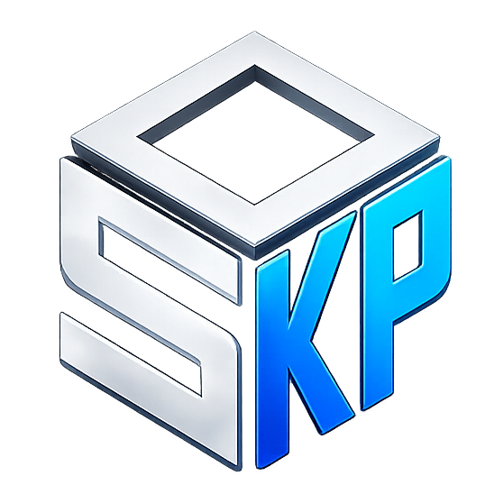
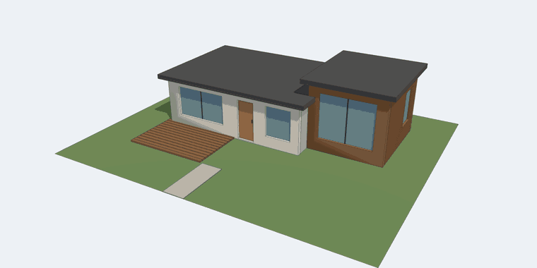
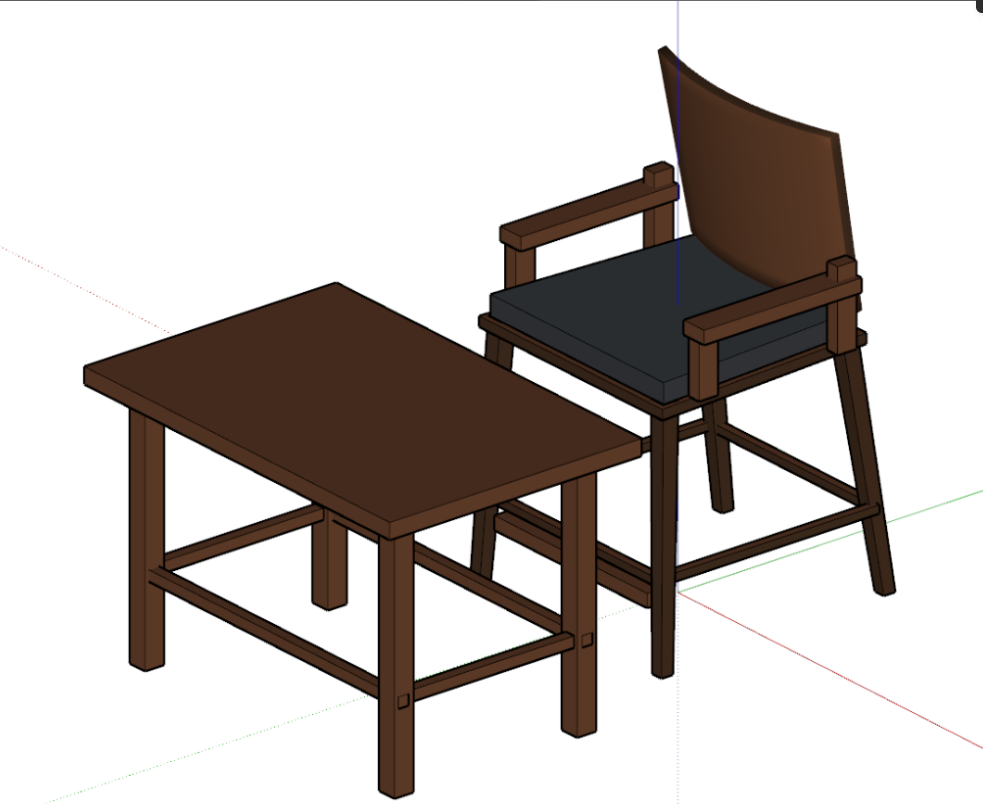
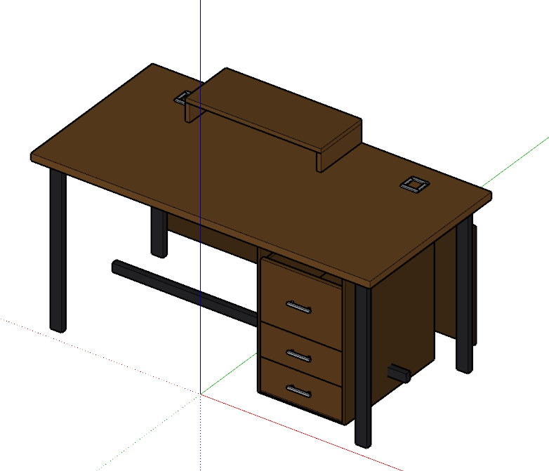
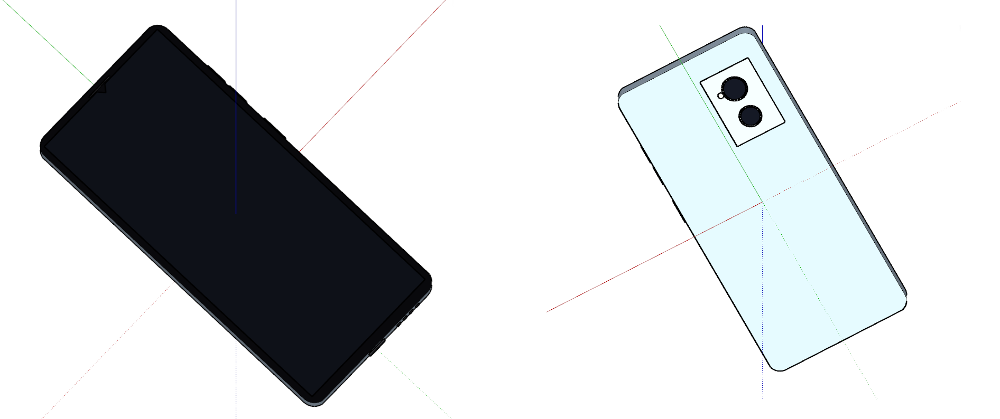

> Tradução para o português do Brasil do [README.md](README.md), baseada no commit `68a1375` do README em inglês. Em caso de divergência, o [README em inglês](README.md) é a versão de referência.

<div align="center">

[English](README.md) · **Português (Brasil)**



# OpenSKP

**Leia, escreva e converta arquivos `.skp` do SketchUp. Sem SketchUp, sem SDK, sem chave de licença.**

Python · TypeScript · .NET · Dart · C++ · Rust

[](https://pypi.org/project/openskp/)
[](https://www.npmjs.com/package/openskp)
[](https://www.nuget.org/packages/OpenSkp)
[](https://pub.dev/packages/openskp)
[](https://github.com/iamahsanmehmood/openskp/releases?q=cpp-)
[](https://opensource.org/licenses/MIT)
<br>
[](https://pepy.tech/projects/openskp)
[](https://www.npmjs.com/package/openskp)
[](https://github.com/iamahsanmehmood/openskp/graphs/contributors)
[](https://github.com/iamahsanmehmood/openskp)

### [Experimente no navegador](https://iamahsanmehmood.github.io/openskp/) · [Documentação](https://iamahsanmehmood.github.io/openskp/docs/) · [openskp.com](https://openskp.com) · [Discussões](https://github.com/iamahsanmehmood/openskp/discussions)



<sub>[modern_house.skp](examples/web-viewer/samples/modern_house.skp): criado com [um script em Python](examples/web-viewer/samples/make_modern_house.py), lido e convertido para GLB pelo OpenSKP, sem o SketchUp.</sub>

</div>

```bash
pip install openskp
```

```python
from openskp import SkpFile
from openskp.export import glb

skp = SkpFile.open("house.skp")
model = skp.parse()                  # layers, components, faces, materials, scenes ...
glb.export(skp, "house.glb")         # ... or OBJ, STL, PLY, DXF, IFC4 and JSON
```

O mesmo em [TypeScript](#-typescript--javascript), [.NET](#-net--c), [Dart](#-dart--flutter), [C++](#%EF%B8%8F-c17--cmake) e [Rust](packages/rust/README.md).

<div align="center">

**⭐ Se o OpenSKP for útil para você, [dê uma estrela](https://github.com/iamahsanmehmood/openskp). Isso ajuda outras pessoas a encontrá-lo.**

**Quer ajudar?** Comece por uma [good first issue](https://github.com/iamahsanmehmood/openskp/issues?q=is%3Aissue+is%3Aopen+label%3A%22good+first+issue%22) ou pergunte nas [Discussões](https://github.com/iamahsanmehmood/openskp/discussions).

[Início rápido](#-início-rápido) · [Recursos](#-recursos) · [Feito por IA também](#-feito-por-ia-também) · [Em destaque](#-em-destaque) · [Usado em produção](#-usado-em-produção) · [Feito com OpenSKP](#-feito-com-openskp) · [Documentação](#-documentação) · [Como contribuir](#-como-contribuir)

</div>

---

## 🌟 O que é o OpenSKP?

O OpenSKP é um kit de ferramentas open source para arquivos do SketchUp (`.skp`), construído inteiramente por engenharia reversa. Cada linguagem tem sua própria implementação nativa, e não um binding em torno de um núcleo compartilhado.

- **Leia** arquivos do SketchUp 2021+ e os clássicos, do SketchUp 4 ao 2020 ([exceções conhecidas](docs/LANGUAGE_PARITY.md#4-real-sketchup-file-version-support)): geometria, materiais e texturas, componentes, tags, cenas, cotas e atributos.
- **Escreva** modelos reais e editáveis do zero, ou estenda um arquivo existente com `open_existing()`. Os arquivos são salvos no formato do SketchUp 2017. Veja [Recursos de escrita](docs/DEVELOPER_GUIDE.md#write-capabilities) e [como cada escritor é verificado](docs/LANGUAGE_PARITY.md#writer-validation).
- **Converta** para GLB, OBJ, STL, PLY, DXF, IFC4 e JSON sem nenhum SDK de CAD ou BIM, e também de e para Fragments (`.frag`). Veja [Recursos de exportação](docs/DEVELOPER_GUIDE.md#export-capabilities).
- **Gere código** que reconstrói um modelo, por exemplo como ponto de partida para um agente de programação com IA ou para comparar dois modelos como texto. Veja [Gerando código a partir de um arquivo](docs/DEVELOPER_GUIDE.md#generating-code-from-a-file).

Python, TypeScript, .NET, Dart e C++ são pacotes publicados; o Rust está no `main` e ainda não está no crates.io. Nem todo recurso existe em todas as linguagens: veja a [tabela de recursos](#-recursos-por-linguagem).

> [!IMPORTANT]
> Este projeto foi construído por engenharia reversa de um formato binário proprietário. Ele não é afiliado à Trimble Inc. nem ao SketchUp, e não é endossado por eles.

---

## ✨ Recursos

| Recurso | Status | Descrição |
|:--------|:------:|:----------|
| **Ler SKP 2021+ (VFF)** | ✅ | Suporte completo ao moderno contêiner binário VFF |
| **Ler SKP clássico 4–2020 (MFC)** | ✅ | Contêiner clássico MFC `CArchive`, com o mesmo formato de saída do VFF. Há suporte ao SketchUp 4–2020 (e ao SketchUp 3 no `main` desde o #705, ainda sem release), com uma lacuna conhecida em um arquivo V5 encontrado na prática; veja [docs/LANGUAGE_PARITY.md § 4](docs/LANGUAGE_PARITY.md#4-real-sketchup-file-version-support) |
| **Extração de geometria 3D** | ✅ | Vértices, arestas, faces, normais e coordenadas UV |
| **Hierarquia de componentes** | ✅ | Definições de componentes aninhadas e transformações de instâncias |
| **Geração de cena / triangulação** | ✅ | Geração de cena opcional: o grafo completo da cena posicionada, resolvido em coordenadas do mundo, triangulado e pronto para GLB, nas cinco linguagens |
| **Camadas / Tags** | ✅ | Definições de camadas com cores e visibilidade (estado `hidden`), totalmente expostas nas cinco linguagens |
| **Materiais e texturas** | ✅ | Propriedades de materiais, cores, transparência, materiais colorizados e imagens de textura incorporadas |
| **Estilos** | ✅ | `styles[].front_color`/`back_color` (2021+) e as cores de face do modelo, `face_front_color`/`face_back_color` (SketchUp 4–2025), nas cinco linguagens; as cenas mostram as faces sem pintura nessas cores ([#533](https://github.com/iamahsanmehmood/openskp/issues/533)) |
| **Componentes dinâmicos** | 🔶 | Dicionários de atributos de instâncias e faces extraídos nas cinco linguagens (2021+ e pré-2021); os dicionários no nível de **definição e de modelo** (fórmulas/opções de Componentes Dinâmicos) estão completos apenas no Python; veja [a tabela](docs/LANGUAGE_PARITY.md#2-feature-matrix) |
| **Observabilidade** | ✅ | Relatório de progresso opcional + erros estruturados que informam a localização; veja [docs/OBSERVABILITY.md](docs/OBSERVABILITY.md) |
| **Converter para GLB / OBJ / STL / PLY / DXF 3D / IFC4 / JSON** | ✅ | Conversão nativa, feita do zero, para glTF (GLB), Wavefront OBJ, STL, PLY, DXF 3D (malha poliface do AutoCAD), IFC4 (BIM) e metadados JSON, disponível nas cinco linguagens e sem SDK de CAD/BIM de terceiros; veja [Recursos de exportação](docs/DEVELOPER_GUIDE.md#export-capabilities) |
| **Converter para Fragments (.frag)** | ✅ | Exportação direta do SketchUp para [ThatOpen Fragments](https://github.com/ThatOpen/engine_fragment), voltada a visualizadores BIM na web, sem intermediário IFC. Publicado em Python (`openskp[fragments]`), TypeScript, .NET (`OpenSkp.Fragments`) e C++; no `main` (não publicado no pub.dev) em Dart (`openskp_fragments`). Veja [docs/LANGUAGE_PARITY.md § Fragments](docs/LANGUAGE_PARITY.md#fragments-frag-support) e [Exportação Fragments](docs/DEVELOPER_GUIDE.md#fragments-export) |
| **Ler de volta um arquivo Fragments (.frag)** | ✅ | Lê a geometria `SHELL` de um `.frag` para um `InstancedScene` (amostras `CIRCLE_EXTRUSION` são ignoradas com um aviso). O Python é verificado com um arquivo real do `IfcImporter` da ThatOpen, além da saída do OpenSKP; TypeScript, .NET, Dart (no `main`, não publicado) e C++ são verificados com ciclos de ida e volta do OpenSKP. Veja [docs/LANGUAGE_PARITY.md § Fragments](docs/LANGUAGE_PARITY.md#fragments-frag-support) e [Lendo de volta um arquivo .frag](docs/DEVELOPER_GUIDE.md#reading-a-frag-file-back) |
| **Escrever arquivos `.skp` nativos** | ✅ | Crie arquivos `.skp` do zero: geometria (incluindo curvas circulares e arcos genuínos, polilinhas livres, faces com furos recortados e triangulação automática de faces não planares), materiais sólidos e texturizados, tags, definições de componentes e grupos aninhados, rotação e visibilidade de instâncias e dicionários de atributos personalizados. Sem SDK em tempo de execução: Python e C++ são verificados contra a biblioteca C do SketchUp, enquanto TypeScript, .NET e Dart são comparados byte a byte com o Python no CI. Veja [Validação do escritor](docs/LANGUAGE_PARITY.md#writer-validation) e [Recursos de escrita](docs/DEVELOPER_GUIDE.md#write-capabilities) |
| **Editar arquivos `.skp` existentes** | ✅ | Carregue um arquivo de formato legado existente e estenda-o: reaproveita seus materiais, tags e definições de componentes, adiciona nova geometria ou instâncias e salva um novo arquivo. Nas cinco linguagens. Veja [Editando um arquivo existente](docs/DEVELOPER_GUIDE.md#editing-an-existing-file) |
| **Gerar código de reconstrução a partir de um arquivo** | ✅ | Transforme um arquivo `.skp` lido em uma transcrição de código-fonte legível e reexecutável, que chama a API de escrita da própria linguagem para reconstruí-lo: materiais, texturas, tags, definições aninhadas, furos, pintura e nomes no nível da instância. Nas cinco linguagens. Veja [Gerando código a partir de um arquivo](docs/DEVELOPER_GUIDE.md#generating-code-from-a-file) |
| **Pronto para agentes de programação com IA** | ✅ | Uma API de escrita genérica e bem documentada (sem auxiliares específicos de objetos) que agentes de programação com IA podem combinar livremente, comprovada em cinco modelos gerados por dois agentes de programação com IA (as três capturas de tela exibidas vêm de um agente, o Antigravity, e as capturas dos modelos de cadeira e casa do primeiro agente ainda estão pendentes), cada um construído a partir de um prompt em linguagem natural ou de uma foto de referência, sem nenhuma biblioteca de primitivas. Veja [Modelos gerados por IA](docs/AI_MODELING.md) |
| **Leitura em streaming / baixo consumo de memória** | ✅ | A leitura preguiçosa dos registros TLV de nível superior limita a memória por definição em Python, TypeScript e C++ (`.NET`/Dart desembrulham apenas `F401`, e o `SkpModel` materializado do TypeScript esbarra nos limites de heap do V8 em arquivos de ~300 MB); veja [Arquitetura de memória](docs/ARCHITECTURE.md#memory-architecture) e [Desempenho](docs/DEVELOPER_GUIDE.md#performance) |
| **Sem SDK do SketchUp** | ✅ | Não exige instalação nem licença do SketchUp. TypeScript, .NET, Dart e Rust não usam dependências nativas; o C++ compila de forma privada os cabeçalhos `miniz`, `TinyGLTF` e `FlatBuffers` via CMake; o Python requer `numpy`, `shapely`, `mapbox_earcut` (wheels nativos pré-compilados), `trimesh` e `defusedxml` |
| **Multiplataforma** | ✅ | Funciona em Linux, macOS e Windows |

---

## 📺 Em destaque

O OpenSKP e seus add-ons para Blender e FreeCAD foram abordados pelo [Blender 3D Architect](https://www.youtube.com/@blender3darchitect), um canal do YouTube sobre Blender para arquitetura:

<table>
<tr>
<td align="center" width="50%">
<a href="https://www.youtube.com/watch?v=q-Gjsa4tuPU"></a><br>
<b>Blender and FreeCAD Can Now Read and Write SketchUp Files</b><br>
<sub>Blender 3D Architect · outubro de 2026</sub>
</td>
<td align="center" width="50%">
<a href="https://www.youtube.com/watch?v=M43s__dC3FM"></a><br>
<b>Blender 5.3 Just Made Importing SketchUp Files Easier Than Ever</b><br>
<sub>Blender 3D Architect · novembro de 2026</sub>
</td>
</tr>
</table>

Também mencionado em:

- **Blender 3D Architect:** [BIMCraft Just Broke Revit's File Lock-In](https://www.youtube.com/watch?v=0uX-DMzZo10), que compara o BIMCraft ao "mesmo tipo de avanço que o OpenSKP trouxe ao mundo do SketchUp"
- **Hacker News:** a discussão que chegou à página inicial sobre o [KetchUp, uma alternativa open source ao SketchUp](https://news.ycombinator.com/item?id=50418176), em que um comentarista observa que ele lê arquivos do SketchUp com o OpenSKP
- **Digital Production:** [IngeTrazo: A Home for the Render Farm](https://digitalproduction.com/2026/10/08/ingetrazo-open-source-architectural-modelling/), sobre a importação de `.skp` do IngeTrazo por meio do OpenSKP

---

## 🏭 Usado em produção

O OpenSKP não é só uma biblioteca: é o motor de leitura do SketchUp por trás de aplicações reais, em uso ativo, em produção:

| Projeto | Descrição | Como usa o OpenSKP |
|:--------|:----------|:-------------------|
|  [FrameSmart](https://frame-smart.com/) | Uma plataforma de colaboração 3D para visualizar, compartilhar e colaborar em modelos 3D junto com seus metadados (IFC, SketchUp e outros), hospedada em Linux. | Alimenta todo o pipeline de importação de SketchUp do FrameSmart, de ponta a ponta. |
| [IngeTrazo](https://ingetrazo.com/) | Um modelador 3D gratuito, com foco em Linux, para engenharia civil e arquitetura: uma alternativa ao SketchUp com uma ponte BIM → IFC. | Substituiu a dependência do IngeTrazo em Wine + DLL proprietária do SketchUp como seu backend nativo de importação de `.skp`. |
| <picture><source media="(prefers-color-scheme: dark)" srcset="assets/users/rayscaper-dark.svg" /></picture> [Rayscaper](https://rayscaper.com/) | Um plugin de renderização fotorrealista para o SketchUp que se atualiza ao vivo enquanto você modela. | Lê modelos `.skp` por meio do OpenSKP. |
| <picture><source media="(prefers-color-scheme: dark)" srcset="assets/users/modlumi-dark.svg" /></picture> [Modlumi](https://modlumi.com/) | Um aplicativo prático de modelagem 3D para designers independentes e artesãos, no Windows e no navegador. | Abre e importa modelos `.skp` existentes por meio do OpenSKP. |
| [Sawhorse](https://sawhorse3d.com/) | Um modelador gratuito, local-first, de empurrar/puxar ao estilo do SketchUp, para marceneiros e makers, no navegador e no desktop. | Abre arquivos `.skp` por meio do pacote npm `openskp`. |

Usa o OpenSKP no seu próprio projeto? [Abra uma issue](https://github.com/iamahsanmehmood/openskp/issues) ou um PR para adicioná-lo aqui.

---

## 🌍 Feito com OpenSKP

Além das aplicações de produção acima, outros desenvolvedores incorporaram o OpenSKP em seus próprios softwares. Estes são os projetos públicos que conseguimos encontrar no GitHub em novembro de 2026; cada um cita o OpenSKP em seu código, avisos ou documentação.

### Aplicativos que abrem ou salvam `.skp` com o OpenSKP

| Projeto | O que é | Como usa o OpenSKP |
|:--------|:--------|:-------------------|
| [Rodeo](https://rodeo.build) | Desenho e modelagem 3D gratuitos e open source no navegador | Abre arquivos `.skp` e salva o modelo 3D como `.skp` com o pacote npm (leitor e escritor) |
| [Hestia BIM](https://www.hestiabim.com) | BIM no navegador para arquitetura residencial | Importa mobiliário do SketchUp com o pacote npm |
| [Serpentine3D](https://github.com/chisomobanzi/Serpentine3D) | Modelador open source de superfícies NURBS sobre o OpenCASCADE | Importa `.skp` em Linux, Windows e Mac com o pacote Python |
| [ToonStudio](https://www.toonstudio.cloud/) | Plataforma de criação de webtoons e web novels | Importa modelos do SketchUp como cenários 3D com o pacote npm |
| [DeepDraw](https://github.com/lihang185/deepdraw) | Alternativa leve ao SketchUp, vinda da China ([archieast.com](http://www.archieast.com)) | Sua importação de `.skp` é a biblioteca C++ do OpenSKP, incorporada via pybind11 |
| [PushForm](https://github.com/PushForm/pushform-app) | Modelador 2D/3D de empurrar/puxar para carpinteiros, arquitetos e paisagistas | Depende do pacote npm para arquivos `.skp` |
| [Arch3D](https://dsalesarchitect.github.io/arch3d/) | Criação BIM leve em Rust e OpenGL | Lê malhas `.skp` por meio do OpenSKP |
| [SketchyUp](https://github.com/zygote55/sketchyup) | Modelador 3D nativo para Linux (C++20, Qt 6) | Inclui uma cópia fixada do OpenSKP para importar `.skp` |
| [Workbench3D](https://github.com/drakeg/workbench3d) | Modelador 3D | Depende do pacote npm |
| [ARCA](https://github.com/enygma-id/arca) | Conversor de BIM para GIS (GeoJSON, GLB, CityJSON, CityGML) | Converte modelos do SketchUp por meio de um adaptador do OpenSKP |
| [acoustic-spaces](https://github.com/naelolaiz/acoustic-spaces) | Pesquisa de simulação de acústica de ambientes | Lê os modelos de salas em SketchUp de um conjunto de dados de acústica |
| [sketchup-to-pdf-converter](https://helggaa.github.io/sketchup-to-pdf-converter/) | Visualizador de `.skp` e exportador de PDF no navegador | Construído com React, Three.js e OpenSKP |

### Leitores portados do OpenSKP ou verificados contra ele

| Projeto | O que é | Relação com o OpenSKP |
|:--------|:--------|:----------------------|
| [ConstructCraft](https://constructcraft.net) | Criação BIM open source em Rust | Seu leitor e escritor de `.skp` são um porte do OpenSKP para Rust |
| [Curiosity XRay.3D](https://github.com/curiosity-ai/x-ray-others) | Leitura de arquivos 3D para a plataforma de busca da Curiosity | Seu leitor de SketchUp em C# segue o layout de registros do OpenSKP, com crédito em seus avisos de terceiros |
| [TeamCraft](https://warr-ev.github.io/TeamCraft/) | PDM/PLM open source em Rust | Incorpora um porte do OpenSKP para Rust para pré-visualizações do SketchUp |
| [Hoard](https://azazel-labs.github.io/Hoard/) | Gerenciador de assets para jogos | Lê `.skp` com um porte do OpenSKP para Rust |
| [ModelCraft](https://getcadcraft.com/apps/modelcraft) | Modelagem 3D de empurrar/puxar (suíte CadCraft) | Seu próprio leitor, verificado contra o pacote npm do OpenSKP |
| [CivilKit CAD](https://civilkit.io/cad/) | Kernel CAD B-rep em Rust e WebAssembly | Seu leitor de `.skp` é verificado contra a saída do OpenSKP |
| [skp2ifc](https://github.com/MTPython406/skp2ifc) | Conversor de SketchUp para IFC4 em Python | Seu leitor é derivado do OpenSKP |

### Add-ons de outros desenvolvedores

| Add-on | Para | O que faz |
|:-------|:-----|:----------|
| [SketchUp Imparator](https://github.com/gurkanerol/sketchup-imparator) | Blender | Importador nativo de `.skp` com o OpenSKP embutido |
| [freecad_sketchup_plugin](https://github.com/djbarrow/freecad_sketchup_plugin) | FreeCAD | Abre modelos `.skp` com grupos, componentes, cores e tags |
| [ingetrazo-skp-dc-import](https://github.com/moominot/ingetrazo-skp-dc-import) | IngeTrazo | Importa componentes dinâmicos do SketchUp |

### Listado em

[awesome-reverse-engineered](https://github.com/alexgaoth/awesome-reverse-engineered) · [3d-resources](https://github.com/devanshutak25/3d-resources) · [Awesome-AECO](https://github.com/osama-ata/Awesome-AECO) · [awesome-digital-built-environment](https://github.com/Z-Arghavan/awesome-digital-built-environment) · a lista de software do [OSArch](https://osarch.org)

Construiu algo com o OpenSKP que não está aqui? [Abra uma issue](https://github.com/iamahsanmehmood/openskp/issues) ou um PR para adicionar.

---

## 🧩 Integrações com CAD/DCC

Importação/exportação nativa de `.skp` para outras ferramentas, construída sobre este projeto, sem SDK da Trimble e sem instalar o SketchUp:

| Add-on | Status | Repositório |
|:-------|:-------|:------------|
| **FreeCAD** | Importação + exportação, com geometria B-rep real (não uma malha triangulada), com a hierarquia de componentes, as cores e as tags. As texturas ainda não são transportadas. | [freecad-openskp](https://github.com/iamahsanmehmood/freecad-openskp) |
| **Blender** | Importação + exportação, com arquitetura de instanciamento por coleções (um componente posicionado 1.000 vezes custa uma malha, não 1.000). Materiais, texturas e tags na importação; cores e tags na exportação. | [blender-openskp](https://github.com/iamahsanmehmood/blender-openskp) · [Blender Extensions](https://extensions.blender.org/add-ons/openskp-import-export/) |

Ambos estão no início e em desenvolvimento ativo: bugs reais são encontrados e corrigidos testando com arquivos reais, e não esperando que tudo fique perfeito. Experimente-os e abra uma issue no repositório do próprio add-on (não aqui) para qualquer questão específica do comportamento do FreeCAD/Blender.

---

## 🖥️ Plataformas suportadas

| Plataforma | Versão | Status | Instalação |
|:-----------|:-------|:------:|:-----------|
| 🐍 **Python** | [](https://pypi.org/project/openskp/) | ✅ Disponível | `pip install openskp` |
| 📘 **TypeScript / JS** | [](https://www.npmjs.com/package/openskp) | ✅ Disponível | `npm install openskp` |
| 🚀 **.NET / C#** | [](https://www.nuget.org/packages/OpenSkp) | ✅ Disponível | `dotnet add package OpenSkp` |
| 🎯 **Dart / Flutter** | [](https://pub.dev/packages/openskp) | ✅ Disponível | `dart pub add openskp` |
| ⚙️ **C++17** | [](https://github.com/iamahsanmehmood/openskp/releases?q=cpp-) | ✅ Pacote de código-fonte | `find_package(OpenSkp CONFIG REQUIRED)` |

As cinco linguagens estão na versão **1.7.0**, a partir do lançamento sincronizado de 25/11/2026. O número de versão é o mesmo, e a capacidade, quase: só o Python escreve cenas (`add_scene`), e algumas diferenças menores estão listadas abaixo. As cinco leem tanto o moderno contêiner VFF (2021+) quanto o clássico MFC (SketchUp 4–2020) de `.skp`, e oferecem as mesmas APIs opcionais de geração de cena (`buildScene()`) e de observabilidade. Os detalhes completos sobre o que difere entre as linguagens, e quais versões reais de arquivos do SketchUp são lidas hoje, estão na seção logo abaixo.

---

## 🔀 Recursos por linguagem

Todos os recursos, nas 5 linguagens: ✅ disponível e publicado, ❌ ainda não portado. O detalhamento completo (incluindo as nuances de `n/a`/"não verificado de forma independente") está em **[docs/LANGUAGE_PARITY.md](docs/LANGUAGE_PARITY.md)**; esta é a versão resumida.

| Recurso | Python | TypeScript | .NET | Dart | C++ |
|:---|:---:|:---:|:---:|:---:|:---:|
| Ler VFF (2021+) e MFC clássico (SketchUp 4–2020; [§4](docs/LANGUAGE_PARITY.md#4-real-sketchup-file-version-support)) | ✅ | ✅ | ✅ | ✅ | ✅ |
| Geometria, tags, materiais/texturas | ✅ | ✅ | ✅ | ✅ | ✅ |
| Estilos e as cores de face do modelo (`face_front_color`/`face_back_color`), usadas nas cenas | ✅ | ✅ | ✅ | ✅ | ✅ |
| Componentes dinâmicos / dicionários de atributos (instância/face nas 5; dicionários de definição e de modelo completos no Python) | ✅ | 🔶 | 🔶 | 🔶 | 🔶 |
| Dicionários de atributos: multidicionário + valores tipados (`Point3d`/`Length`/listas aninhadas; 9/9 clássico e VFF) | ✅ | ✅ | ✅ | ✅ | ✅ |
| Dicionários de atributos expostos nos metadados de exportação GLB/JSON (não apenas nos Psets IFC) | ✅ | ❌ | ❌ | ❌ | ✅ JSON |
| Páginas/cenas VFF + leitura de cotas | ✅ | ✅ | ✅ | ✅ | ✅ |
| Leitura de páginas/cenas legadas (pré-2021) | ✅ com câmeras (2014–2020) | ✅ | ✅ | ✅ | ✅ |
| Leitura de linhas/pontos de construção | ✅ legado + VFF | ✅ | ✅ | ✅ | ✅ legado + VFF |
| Geração de cena, saída de cena que preserva instanciamento | ✅ | ✅ | ✅ | ✅ | ✅ |
| Suporte a curvas de arestas soltas (estruturas) | ✅ | ✅ | ✅ | ✅ | ✅ |
| Escritor: materiais/tags/definições/grupos/faces/curvas/imagens | ✅ | ✅ | ✅ | ✅ | ✅ |
| Escritor: cotas, planos de corte, geometria de construção | ✅ | ✅ | ✅ | ✅ | ✅ |
| Escritor: cenas (câmera + camadas ocultas) | ✅ | ❌ | ❌ | ❌ | ❌ |
| Editor (`open_existing()`), gerador de código | ✅ | ✅ | ✅ | ✅ | ✅ |
| Exportação: GLB / OBJ / STL / PLY / DXF / IFC4 / JSON | ✅ | ✅ | ✅ | ✅ | ✅ |
| Correções de exportação IFC (unidades, visibilidade de camadas, Psets, classificação) | ✅ | ✅ | ✅ | ✅ | ✅ |
| Anotações de curvas/arcos IFC (`IfcAnnotation`/`IfcArcIndex`) | ✅ | ✅ | ✅ | ✅ | ✅ |
| **Exportação Fragments (`.frag`)** ([detalhes](docs/LANGUAGE_PARITY.md#fragments-frag-support)) | ✅ | ✅ | ✅ | 🔶 no `main`, não publicado | ✅ |
| **Importação Fragments (`.frag`)** ([detalhes](docs/LANGUAGE_PARITY.md#fragments-frag-support)) | ✅ | ✅ | ✅ | 🔶 no `main`, não publicado | ✅ |

### Suporte a versões reais de arquivos do SketchUp

Arquivos MFC clássicos do **SketchUp 4 ao 2020** e arquivos VFF modernos do **SketchUp 2021+** são lidos nas cinco linguagens, com uma exceção conhecida (um arquivo real do SketchUp 5 encontrado na prática falha no TypeScript); arquivos reais do SketchUp 3 são lidos em todos os leitores no `main` desde o #705, ainda sem release. Na escrita, `create()` e `open_existing()` emitem uma base MFC clássica do **SketchUp 2017** (`{17.0.1}`) (`blank_v17.skp`), que o SketchUp 2017 e posteriores abrem nativamente.

Tabela completa de status por versão e por linguagem, com as evidências (fixtures sintéticas, arquivos gravados pelo SDK e a varredura de várias versões com arquivos reais): **[docs/LANGUAGE_PARITY.md § 4](docs/LANGUAGE_PARITY.md#4-real-sketchup-file-version-support)**.

---

## 🚀 Início rápido

Escolha sua linguagem: cada exemplo abaixo roda contra a API pública atual (verificado na redação do README original). Para o quadro completo (a etapa opcional `buildScene()` para malhas trianguladas, orientações de memória/desempenho, progresso + observabilidade de erros, suporte a formatos legados e a API completa de escritor/editor), veja o **[Guia do Desenvolvedor](docs/DEVELOPER_GUIDE.md)**.

### 🐍 Python

```bash
pip install openskp
```

```python
from openskp import SkpFile

model = SkpFile.open("my_model.skp").parse()

print(f"SketchUp version: {model.version}")
print(f"Layers: {[l.name for l in model.layers]}")

for def_id, defn in model.definitions.items():
    print(f"{defn.name}: {len(defn.vertices)} verts, {len(defn.faces)} faces")

for material in model.materials:
    print(f"Material: {material.name}", "(has texture)" if material.texture else "")

# Opt-in: full placed scene graph, triangulated, world-space, GLB-ready
scene = SkpFile.open("my_model.skp").build_scene()
print(f"{len(scene.glb_primitives)} renderable mesh primitives")
```

**Escrita:**

```python
from openskp import create

builder = create()
red = builder.add_material("Red", (255, 0, 0))
with builder.add_component_definition("Chair") as chair:
    chair.add_face([(0, 0, 0), (20, 0, 0), (20, 20, 0), (0, 20, 0)])
builder.add_instance(chair, translation=(50, 0, 0))
builder.add_instance(chair, translation=(100, 0, 0), hidden=True)
builder.add_face([(0, 0, 0), (100, 0, 0), (100, 100, 0), (0, 100, 0)], material=red)
builder.save("output.skp")
```

E para estender um arquivo que já existe, em vez de começar do zero, use `open_existing()`; veja [Editando um arquivo existente](docs/DEVELOPER_GUIDE.md#editing-an-existing-file) no Guia do Desenvolvedor.

### 📘 TypeScript / JavaScript

```bash
npm install openskp
```

```typescript
import { SkpFile, toGLB } from 'openskp';

// Node.js
const model = SkpFile.open('my_model.skp').parse();

// Browser (isomorphic - same package, no Node APIs)
// const buffer = await fetch('my_model.skp').then(r => r.arrayBuffer());
// const model = parseSkp(buffer);

console.log(model.version, model.layers);

// Opt-in: full placed scene graph, triangulated, world-space, GLB-ready
const scene = SkpFile.open('my_model.skp').buildScene();
const glb = toGLB(scene);   // ready to write to a .glb file
```

**Escrita:**

```typescript
import { create } from 'openskp';

const builder = create();
const red = builder.addMaterial('Red', [255, 0, 0]);
const chair = builder.addComponentDefinition('Chair', (def) => {
  def.addFace([[0, 0, 0], [20, 0, 0], [20, 20, 0], [0, 20, 0]]);
});
builder.addInstance(chair, { translation: [50, 0, 0] });
builder.addInstance(chair, { translation: [100, 0, 0], hidden: true });
builder.addFace([[0, 0, 0], [100, 0, 0], [100, 100, 0], [0, 100, 0]], { material: red });
builder.save('output.skp');   // Node.js; use builder.toBytes() in the browser
```

### 🚀 .NET / C#

```bash
dotnet add package OpenSkp
```

```csharp
using OpenSkp;

var model = SkpFile.Open("my_model.skp");
Console.WriteLine($"{model.Version} - {model.Layers.Count} layers");

// Opt-in: full placed scene graph, triangulated, world-space, GLB-ready
var scene = SkpFile.BuildScene("my_model.skp");
Console.WriteLine($"{scene.GlbPrimitives.Count} renderable mesh primitives");

var glb = GlbExport.ToGlb(scene);       // ready to write to a .glb file
GlbExport.ExportGlb(scene, "my_model.glb");
IfcExport.ExportIfc(scene, "my_model.ifc");
```

**Escrita:**

```csharp
var builder = SkpCreate.NewFile();
int red = builder.AddMaterial("Red", (255, 0, 0));
var chair = builder.AddComponentDefinition("Chair");
using (chair)
{
    chair.AddFace(new (double, double, double)[] { (0, 0, 0), (20, 0, 0), (20, 20, 0), (0, 20, 0) });
}
builder.AddInstance(chair, translation: (50, 0, 0));
builder.AddInstance(chair, translation: (100, 0, 0), hidden: true);
builder.AddFace(new (double, double, double)[] { (0, 0, 0), (100, 0, 0), (100, 100, 0), (0, 100, 0) }, material: red);
builder.Save("output.skp");
```

### 🎯 Dart / Flutter

```bash
dart pub add openskp
```

```dart
import 'package:openskp/openskp.dart';

final model = SkpFile.open('my_model.skp').parse();
print('${model.version} - ${model.layers.length} layers');

// Opt-in: full placed scene graph, triangulated, world-space, GLB-ready
final scene = SkpFile.open('my_model.skp').buildScene();
print('${scene.glbPrimitives.length} renderable mesh primitives');

final glb = toGlb(scene);               // ready to write to a .glb file
exportGlb(scene, 'my_model.glb');
exportIfc(scene, 'my_model.ifc');
```

**Escrita:**

```dart
final builder = create();
final red = builder.addMaterial('Red', [255, 0, 0]);
final chair = builder.addComponentDefinition('Chair', (def) {
  def.addFace([(0.0, 0.0, 0.0), (20.0, 0.0, 0.0), (20.0, 20.0, 0.0), (0.0, 20.0, 0.0)]);
});
builder.addInstance(chair, translation: (50.0, 0.0, 0.0));
builder.addInstance(chair, translation: (100.0, 0.0, 0.0), hidden: true);
builder.addFace([(0.0, 0.0, 0.0), (100.0, 0.0, 0.0), (100.0, 100.0, 0.0), (0.0, 100.0, 0.0)], material: red);
builder.save('output.skp');
```

### ⚙️ C++17 / CMake

```cmake
find_package(OpenSkp CONFIG REQUIRED)
target_link_libraries(your_target PRIVATE OpenSkp::OpenSkp)
```

```cpp
#include <openskp/openskp.hpp>

auto skp = openskp::SkpFile::open("my_model.skp");
auto model = skp.parse();
auto scene = skp.build_scene();
auto glb = openskp::to_glb(scene);
openskp::export_glb(scene, "my_model.glb");
openskp::export_ifc(scene, "my_model.ifc");
```

**Escrita:**

```cpp
using namespace openskp;

auto builder = create();
int red = builder->add_material("Red", Color3{255, 0, 0});
auto& chair = builder->add_component_definition("Chair");
chair.add_face({{0, 0, 0}, {20, 0, 0}, {20, 20, 0}, {0, 20, 0}});
chair.close();

InstanceOptions opts1;
opts1.translation = {50, 0, 0};
builder->add_instance(chair, opts1);

InstanceOptions opts2;
opts2.translation = {100, 0, 0};
opts2.hidden = true;
builder->add_instance(chair, opts2);

FaceOptions face_opts;
face_opts.material = red;
builder->add_face({{0, 0, 0}, {100, 0, 0}, {100, 100, 0}, {0, 100, 0}}, face_opts);

builder->save("output.skp");
```

---

## 🤖 Feito por IA também

O escritor acima é, de propósito, uma API genérica e bem documentada: sem `add_chair()` ou `add_staircase()`, apenas materiais, faces, componentes e instâncias. Isso acaba fazendo dele um alvo particularmente bom para agentes de programação com IA: cinco modelos de demonstração foram gerados a partir de prompts em linguagem natural (ou de fotos de referência) por dois agentes de programação com IA, usando apenas a API crua documentada acima (os três mostrados abaixo foram gerados pelo Antigravity; as capturas de tela dos modelos de cadeira e casa do primeiro agente estão pendentes):

<table>
<tr>
<td width="33%" align="center">
<br>
<sub>Poltrona + mesa lateral: pernas cônicas, encosto curvo tesselado</sub>
</td>
<td width="33%" align="center">
<br>
<sub>Mesa executiva: 8 definições de componentes aninhadas</sub>
</td>
<td width="33%" align="center">
<br>
<sub>Smartphone: modelado diretamente a partir de uma foto de referência do produto</sub>
</td>
</tr>
</table>

Veja [Modelos gerados por IA](docs/AI_MODELING.md) para o texto completo: por que isso funciona, mais exemplos (incluindo trechos de código reais e as contagens exatas de componentes/materiais), como apontar hoje o seu próprio agente de programação com IA para o OpenSKP e direções em aberto para contribuidores (um ciclo de renderização/validação, a avaliação de um servidor MCP, mais modelos de demonstração).

---

## 🏛️ Arquitetura

Dois fluxos independentes, ambos nativos nas cinco linguagens: **ler e converter** um arquivo `.skp` existente, e **escrever** um novo (ou editar um existente) a partir do nada, usando a mesma API pública.

```mermaid
graph TB
    subgraph read[" Reading and converting "]
        direction LR
        SKP1[".skp file<br/>VFF 2021+ or<br/>classic MFC 4-2020"] --> WALK["Streaming TLV walk<br/>one top-level record<br/>at a time"]
        WALK --> RAW["Raw parsed data<br/>defs · layers ·<br/>materials · styles"]
        RAW --> PARSE["parse()<br/>-> SkpModel<br/>no scene resolution"]
        RAW --> SCENE["buildScene()<br/>-> Scene<br/>triangulated, world-space"]
        SCENE --> CONVERT["Convert to 7 formats<br/>GLB · OBJ · STL · PLY<br/>DXF · IFC4 · JSON"]
    end

    subgraph write[" Writing and editing "]
        direction LR
        NEW["create()"] --> SPLICE["Splice new entities into<br/>SketchUp 2017 scaffold"]
        SKP2[".skp file<br/>to extend"] --> EDIT["open_existing()<br/>parse -> replay -> extend"]
        EDIT --> SPLICE
        SPLICE --> OUT["New .skp file"]
    end

    style SKP1 fill:#f59e0b,color:#000,stroke:#d97706
    style SKP2 fill:#f59e0b,color:#000,stroke:#d97706
    style RAW fill:#8b5cf6,color:#fff,stroke:#7c3aed
    style SPLICE fill:#8b5cf6,color:#fff,stroke:#7c3aed
    style PARSE fill:#3b82f6,color:#fff,stroke:#2563eb
    style SCENE fill:#3b82f6,color:#fff,stroke:#2563eb
    style NEW fill:#3b82f6,color:#fff,stroke:#2563eb
    style EDIT fill:#3b82f6,color:#fff,stroke:#2563eb
    style CONVERT fill:#10b981,color:#fff,stroke:#059669
    style OUT fill:#10b981,color:#fff,stroke:#059669
```



A **leitura** percorre a árvore TLV um registro de nível superior por vez, em vez de materializar tudo na memória, o que permite que Python, .NET e Dart lidem com arquivos reais de produção com mais de 100.000 definições de componentes (em Python, TypeScript e C++, a memória da leitura é limitada por definição por meio do desembrulho de `F901 > 7017 > 7117`; `.NET` e `Dart` desembrulham apenas `F401`, e o `SkpModel` materializado do TypeScript ainda esbarra no limite de heap por objeto do V8 em arquivos de ~300 MB; veja [Desempenho](docs/DEVELOPER_GUIDE.md#performance)). `parse()` (leve, por definição) e `buildScene()` (opcional, grafo completo da cena posicionada) são deliberadamente separados, para que o caso comum nunca pague por uma resolução de grafo de cena de que não precisa.

A **escrita** tem o formato oposto: em vez de percorrer uma entrada grande em streaming, ela insere novas entidades class-ref/back-ref em uma base pequena, declarada abertamente, de documento em branco criada pelo SDK, o mesmo protocolo que [docs/BINARY_FORMAT.md](docs/BINARY_FORMAT.md) documenta para a leitura, só que invertido. O `open_existing()` reaproveita isso: primeiro lê completamente um arquivo de origem e depois reproduz tudo o que entendeu por meio da mesma API de escrita, antes que qualquer geometria nova seja adicionada.

> 📖 Para o detalhamento completo da arquitetura, incluindo o modelo de memória, o projeto de inserção na base do escritor, por que o .NET precisou de uma correção de memória realmente diferente e como as partes internas das cinco linguagens se correspondem, veja [docs/ARCHITECTURE.md](docs/ARCHITECTURE.md).

---

## 📁 Estrutura do projeto

```
openskp/
├── README.md                  # You are here
├── LICENSE                    # MIT License
├── CONTRIBUTING.md            # Contribution guide
├── CODE_OF_CONDUCT.md         # Contributor Covenant v2.1
├── CHANGELOG.md               # Release history
│
├── packages/
│   ├── python/                # 🐍 Python implementation — parse + write
│   │   ├── src/openskp/       # _core.py, legacy.py, model.py, scene.py, create.py, edit.py, ...
│   │   └── tests/
│   ├── typescript/            # 📘 TypeScript / JavaScript implementation — parse + write
│   │   ├── src/                # index.ts, model.ts, legacy.ts, create.ts, edit.ts, observability.ts, ...
│   │   └── tests/
│   ├── dotnet/                # 🚀 .NET / C# implementation — parse + write + Fragments
│   │   ├── OpenSkp/            # Core.cs, Legacy.cs, Model.cs, Scene.cs, Create.cs, Edit.cs, ...
│   │   ├── OpenSkp.Tests/
│   │   ├── OpenSkp.Fragments/  # Separate NuGet package for ThatOpen Fragments (.frag) export/import
│   │   └── OpenSkp.Fragments.Tests/
│   ├── dart/                  # 🎯 Dart / Flutter implementation — parse + write
│   │   ├── lib/src/            # core.dart, legacy.dart, model.dart, scene.dart, create.dart, edit.dart, ...
│   │   └── test/
│   ├── dart_fragments/        # 🎯 Dart Fragments (.frag) export/import (on main, not published to pub.dev)
│   │   ├── lib/
│   │   └── test/
│   ├── cpp/                   # ⚙️ C++17 / CMake implementation — parse + write
│   │   ├── include/openskp/    # Public API (create.hpp, edit.hpp, fragments_export.hpp, ...)
│   │   ├── src/                # Parser, scene, writer, and exporter implementation
│   │   └── tests/
│   └── rust/                  # 🦀 Pure-Rust implementation (std only; not on crates.io yet)
│       ├── src/                # Parser, scene, writer, and exporters
│       ├── tests/
│       └── viewer/             # In-browser wasm32 + WebGL2 viewer
│
├── examples/
│   ├── web-viewer/             # Drag-and-drop 3D viewer (TypeScript + Three.js),
│   │                           # deployed live via GitHub Pages
│   └── python/                 # Python usage examples
│
├── docs/                       # 📖 Documentation
│   ├── DEVELOPER_GUIDE.md      # Start here — the detailed cross-language guide
│   ├── LANGUAGE_PARITY.md      # Canonical feature, version-support, Fragments, and writer-validation tables
│   ├── AI_MODELING.md          # AI coding agents as a writer target, with real examples
│   ├── OBSERVABILITY.md        # Progress reporting + structured errors, in depth
│   ├── ARCHITECTURE.md         # Library architecture, memory model, writer design
│   ├── API_DESIGN.md           # Cross-platform API quick reference
│   ├── BINARY_FORMAT.md        # Reverse-engineered 2021+ VFF/TLV format spec
│   └── assets/                 # Images referenced by the docs above
│
├── research/                   # 🔬 Research notes
│   └── METHODOLOGY.md          # Reverse engineering methodology
│
└── .github/
    ├── workflows/               # CI, per-language release, GitHub Pages deploy
    ├── PULL_REQUEST_TEMPLATE.md
    └── ISSUE_TEMPLATE/
```

---

## 🔬 Como funciona

Os arquivos `.skp` do SketchUp usam um formato binário proprietário chamado **VFF** (introduzido no SketchUp 2021). Veja como o OpenSKP os lê:

### 1. Validação do cabeçalho
Todo arquivo SKP começa com um marcador mágico (`FF FE FF 0E`) seguido de uma string de versão em UTF-16LE. O OpenSKP valida esse cabeçalho para confirmar a compatibilidade do formato.

### 2. Extração do ZIP
O arquivo SKP é um arquivo ZIP (que vem depois do cabeçalho). Dentro dele você encontra:
- **`model.dat`**: a carga binária de geometria (codificada em TLV)
- **`materials/*/material.xml`**: definições de materiais e texturas
- **`meta/*.png`**: miniaturas e imagens de pré-visualização

### 3. Leitura TLV
O `model.dat` binário usa a codificação **TLV (Tag-Length-Value)**:
- **Tag**: identificador de 2 bytes (little-endian)
- **Length**: tamanho da carga em 4 bytes (little-endian)
- **Value**: bytes brutos com o tamanho especificado

Algumas tags são *contêineres*: sua carga é uma sequência de elementos TLV aninhados, formando uma estrutura em árvore.

### 4. Construção do modelo
O OpenSKP mapeia as tags conhecidas para primitivas de geometria, hierarquias de componentes, tags (camadas) e materiais, construindo um objeto de modelo estruturado e consultável.

### 5. Conversão de coordenadas
O SketchUp usa um sistema de coordenadas **Z para cima, em polegadas**. A mesma troca de eixos para Y para cima vale em todo o OpenSKP; só a escala de unidade muda conforme o contexto. Para as posições de vértices do GLB (Y para cima, em **metros**, conforme a especificação do glTF):

```
x_m =  x_inches × 0.0254
y_m =  z_inches × 0.0254
z_m = -y_inches × 0.0254
```

Os campos `position_mm` do grafo de cena (`InstanceNode`/`MeshMetadata`) usam a mesma troca de eixos, mas em **milímetros** (`× 25.4`), já que são metadados para posicionamento/inspeção e não dados de vértice voltados ao renderizador.

> 📖 O que foi dito acima cobre o moderno contêiner VFF (2021+). Os arquivos anteriores a 2021 usam um contêiner completamente diferente (um fluxo de grafo de objetos MFC `CArchive` clássico, sem ZIP) — o OpenSKP detecta e trata o SketchUp 4–2020 de forma transparente por trás da mesma chamada `parse()`. Veja [docs/LANGUAGE_PARITY.md § 4](docs/LANGUAGE_PARITY.md#4-real-sketchup-file-version-support) para o suporte por versão, [a seção sobre formato legado do Guia do Desenvolvedor](docs/DEVELOPER_GUIDE.md#legacy-format-support-sketchup-42020) para os detalhes e [docs/BINARY_FORMAT.md](docs/BINARY_FORMAT.md) para a especificação completa do VFF/TLV.

### Escrita

Todo escritor produz apenas um contêiner **MFC clássico do SketchUp 2017 (`{17.0.1}`)**, nunca VFF: o SketchUp 2017 e posteriores o abrem nativamente, e foi com base nesse formato que a lógica de escritor/editor deste projeto foi submetida a engenharia reversa. Em vez de sintetizar um arquivo a partir do nada, o escritor de cada linguagem inclui uma pequena [base de documento em branco do SketchUp 2017 criada pelo SDK](packages/python/src/openskp/create.py), declarada abertamente (`blank_v17.skp`), e insere nela novas entidades do grafo de objetos class-ref/back-ref, a mesma codificação que [docs/BINARY_FORMAT.md](docs/BINARY_FORMAT.md) documenta para a leitura, só que invertida. Veja [Recursos de escrita](docs/DEVELOPER_GUIDE.md#write-capabilities) no Guia do Desenvolvedor para a API completa e o comportamento.

### Conversão

`parse()` e `buildScene()` também são a primeira metade de um conversor, e não apenas de um leitor: a saída de `buildScene()` (triangulada, em coordenadas do mundo, agrupada por material) tem exatamente o formato de que o exportador de cada formato precisa, de modo que converter `.skp` → GLB/OBJ/STL/PLY/DXF/IFC4/JSON é um serializador feito do zero para cada formato, sobre esses mesmos dados, em todas as linguagens, sem SDK intermediário de CAD/BIM e sem chamar outra ferramenta. A conversão no sentido inverso (glTF/IFC/OBJ → `.skp`) reaproveita o escritor acima da mesma forma: constrói-se um `SkpBuilder` a partir da geometria do outro formato, em vez de a partir de um esboço novo, uma direção futura planejada que ainda não foi iniciada. Veja [Recursos de exportação](docs/DEVELOPER_GUIDE.md#export-capabilities) no Guia do Desenvolvedor para a API completa de cada linguagem.

---

## 📖 Documentação

### 🌐 [iamahsanmehmood.github.io/openskp/docs/](https://iamahsanmehmood.github.io/openskp/docs/)

Um site de documentação navegável: instalação/início rápido por linguagem, o modelo de dados, números de memória e desempenho, observabilidade, tratamento de erros e as diferenças conhecidas entre os cinco portes, tudo em um só lugar. Publicado junto com o [visualizador web](https://iamahsanmehmood.github.io/openskp/) a partir de [`examples/web-viewer/docs/`](examples/web-viewer/docs/).

O texto-fonte completo de cada tópico também está aqui, em Markdown simples (em inglês):

| Documento | Descrição |
|:----------|:----------|
| [Guia do Desenvolvedor](docs/DEVELOPER_GUIDE.md) | **Comece por aqui.** O guia detalhado e verificado entre linguagens: API, memória/desempenho, formato legado, tratamento de erros e diferenças conhecidas entre os cinco portes |
| [Paridade entre linguagens](docs/LANGUAGE_PARITY.md) | Exatamente quais recursos existem em todas as linguagens e quais são, hoje, exclusivos do Python, mantido em dia conforme os portes avançam |
| [Roadmap](ROADMAP.md) | O que vem a seguir, o que se sabe que está quebrado e por onde começar se você quiser contribuir |
| [Modelos gerados por IA](docs/AI_MODELING.md) | Por que o escritor do OpenSKP funciona bem como alvo de agentes de programação com IA, exemplos reais gerados e direções em aberto para contribuidores |
| [Guia de observabilidade](docs/OBSERVABILITY.md) | Relatório de progresso + erros estruturados, em profundidade |
| [Especificação do formato binário](docs/BINARY_FORMAT.md) | Documentação do formato VFF / TLV obtida por engenharia reversa |
| [Arquitetura](docs/ARCHITECTURE.md) | Projeto da biblioteca, modelo de memória e estrutura de módulos |
| [Design da API](docs/API_DESIGN.md) | Referência rápida da API multiplataforma |
| [Metodologia de pesquisa](research/METHODOLOGY.md) | Como fizemos a engenharia reversa do formato |
| [Changelog](CHANGELOG.md) | Histórico de versões e notas de lançamento |
| [Como contribuir](CONTRIBUTING.md) | Como contribuir com o OpenSKP |

---

## 🤝 Como contribuir

Contribuições de todos são bem-vindas! Seja corrigindo um bug, adicionando um recurso, melhorando a documentação ou implementando uma nova plataforma, toda contribuição conta.

```bash
# Clone the repository
git clone https://github.com/iamahsanmehmood/openskp.git
cd openskp

# Python
cd packages/python
python -m venv .venv
source .venv/bin/activate   # or .venv\Scripts\activate on Windows
pip install -e ".[dev]"
pytest

# TypeScript
cd packages/typescript
npm install
npm test

# .NET
cd packages/dotnet/OpenSkp.Tests
dotnet test

# Dart
cd packages/dart
dart pub get
dart test

# C++
cmake -S packages/cpp -B build/cpp -DOPENSKP_BUILD_TESTS=ON
cmake --build build/cpp
ctest --test-dir build/cpp --output-on-failure

# Rust
cd packages/rust
cargo test --release
```

Leia nosso [Guia de contribuição](CONTRIBUTING.md) e o [Código de Conduta](CODE_OF_CONDUCT.md) antes de enviar um pull request.

---

## 📄 Licença

O OpenSKP é distribuído sob a [Licença MIT](LICENSE). Você pode usar, modificar e distribuir este software livremente, em projetos comerciais e não comerciais.

---

## 🙏 Créditos e agradecimentos

**Criado e mantido por [Ahsan Mehmood](https://github.com/iamahsanmehmood)**

Este projeto não seria possível sem:

- [Noor Ali Qureshi](https://github.com/nooraliqureshi): suporte ao SketchUp 2025, correções para versões antigas de SKP, suporte à renderização de materiais e a correção da decodificação UTF-8 no TypeScript.
- [Marco Sumari](https://github.com/tuxiasumari): fidelidade de materiais (texturas, materiais colorizados, materiais de instâncias e do verso das faces, mapeamento UV por face), entidades Image, estilos, flags de exibição de arestas e o leitor inicial do formato MFC clássico.
- [Thomas Loockx](https://github.com/thomasloockx): o porte para C++17, incluindo o pacote CMake, o CI multiplataforma e a suíte de testes.
- A comunidade open source, pela inspiração e pelo feedback
- [Kaitai Struct](https://kaitai.io/), pelos padrões de análise de formatos binários
- A especificação [glTF](https://www.khronos.org/gltf/), do Khronos Group
- Todos que contribuíram com arquivos de teste, relatos de bugs e código

---

<div align="center">

**⭐ Se o OpenSKP é útil para você, considere dar uma estrela no [GitHub](https://github.com/iamahsanmehmood/openskp)!**

Feito com ❤️ por [Ahsan Mehmood](https://github.com/iamahsanmehmood)

</div>
