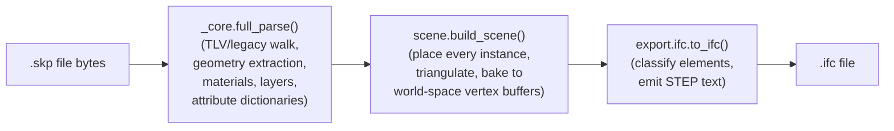

# SKP → IFC Pipeline: Optimization & Control Plan (DRAFT — for discussion)

> Status: **draft, not yet agreed or started.** This document exists to give
> us a shared, concrete basis to discuss before any implementation begins.
> Nothing here is committed to code or to the repo's tracked docs until we've
> talked through it and decided what to build first.

## 1. Why this document exists

The FrameSmart pipeline's sole current use of OpenSKP is: **read a `.skp`
file, produce an IFC file from it.** Two things came up that motivate
writing this down properly instead of continuing to patch one-off bugs:

1. **Performance** — a real production file (Keith Street, ~1GB decompressed
   `model.dat`, 45,749 definitions, 48,300 placed instances) takes a long
   time to convert, and we haven't yet agreed on where to invest effort to
   bring that down.
2. **Control without data loss** — the pipeline should never silently drop
   or degrade something the user didn't ask to drop, but different
   pipeline runs may legitimately want different tradeoffs (a full-fidelity
   export vs. a smaller/faster one for a specific purpose). Right now that
   choice barely exists — the exporter makes most of these decisions for
   the caller.

This document covers **both**: a factual breakdown of where the pipeline
actually spends its time today, and a proposed shape for a configuration
surface that gives the caller explicit control — with **safe, full-fidelity
behavior as the default**, and every reduction in output opt-in, never
opt-out.

## 2. How the pipeline works today



Two important facts about this pipeline, both confirmed on the real Keith
Street file this session:

- **`build_scene()` re-parses the file internally.** It does not accept or
  reuse the result of a separate `.parse()` call. If a caller does both
  (e.g. `.parse()` for validation/metadata, then `.build_scene()` for the
  export), the ~1GB file gets walked twice for no benefit.
- **Almost all wall-clock time is in step B+C (parsing and scene-building),
  not step D (IFC serialization).** Measured on Keith Street:

  | Stage | Time | Share |
  |---|---|---|
  | Open + parse + build scene | ~685s | ~97% |
  | Convert scene → IFC text | ~23s | ~3% |
  | Write IFC file to disk | ~2s | <1% |
  | **Total** | **~710s** | |

  Any optimization conversation should start from this: **the SKP-reading
  side is where the time is**, not the IFC-writing side.

### What step B (parsing) currently always does, unconditionally

- Walks every TLV node in the file (defs, instances, layers, materials).
- Triangulates every mesh-bearing definition, for every placement (baked,
  not instanced — see §4.3).
- Decodes and deduplicates every embedded texture image byte-for-byte,
  even though `to_ifc()` never uses texture pixels, only each material's
  flat RGB color.
- Extracts every attribute dictionary on every instance (SketchUp's own
  Dynamic Components data, plus any third-party plugin dictionaries like
  `fbd-einfo`), regardless of whether the caller's IFC export will end up
  using any of it.

None of this is a bug — it's the right default for a general-purpose
`build_scene()` that has to serve GLB export, JSON export, and IFC export
alike. But an IFC-only pipeline pays for all of it regardless.

## 3. Design goal: full fidelity by default, opt-in reduction

The non-negotiable constraint from this conversation: **we do not want a
version of this pipeline that silently loses data.** So the plan is not
"make IFC export lighter" — it's:

- **Default behavior stays exactly as complete as it is today** (or more
  complete, as we keep fixing gaps like the recent naming/attribute and
  layer-visibility fixes). Nobody's existing pipeline output should get
  smaller or less accurate without them asking for that.
- **Every reduction in scope is an explicit, named, opt-in choice** the
  caller makes — not a hidden default, not a global setting that changes
  behavior for everyone. If FrameSmart wants a faster/leaner export for a
  specific use case (e.g. a quick preview conversion vs. the final
  deliverable), that's a parameter they choose per call, and the choice is
  visible in the generated file/logs so nobody downstream is surprised by
  what's missing.
- **Every option is documented with exactly what it trades away.** No
  option should exist that a caller can enable without understanding the
  cost.

## 4. Candidate control knobs (for discussion — none decided yet)

Each of these is a real, independent lever. They're listed roughly in order
of implementation cost (cheapest first), not necessarily priority — that's
part of what we should decide together.

### 4.1 Stop double-parsing (pipeline-side fix, not a new option)

If the FrameSmart pipeline currently calls both `.parse()` and
`.build_scene()` on the same file, this is a **free, zero-risk win** —
just call `.build_scene()` directly. This needs checking on the pipeline
side, not a code change in OpenSKP itself.

### 4.2 Skip texture decode/dedup when the caller doesn't need it

A new opt-in flag (name TBD, e.g. `decode_textures=False`) that skips
reading/sniffing/deduplicating embedded texture image bytes during
`build_scene()`. Safe for IFC export specifically, since `to_ifc()` never
touches `scene.textures`. **Not safe** for GLB export, which needs them —
this would need to be a flag the caller sets, defaulting to "on" (today's
behavior) so nothing changes unless asked.

### 4.3 Layer/element filtering — exclude by name or pattern

Real files (Keith Street included) carry layers that are pure CAD/PDF
reference material or annotation (`PDF_Geometry`, `PDF_Images`, dimension
and text layers) that may have no business being in a structural IFC
model. A caller-supplied include/exclude list (by exact name, or a
pattern) applied before triangulation would skip that geometry entirely —
both faster and a smaller/cleaner IFC file, if that's what the caller
wants. **This one needs care**: it's the closest of these options to
"data loss," so it should be extremely explicit (the excluded layer names
should be recorded somewhere in the output/log, not silently dropped) and
absolutely never a default.

### 4.4 Attribute-dictionary / property-set export toggle

The naming/attribute-dictionary fix we just shipped adds an
`IFCPROPERTYSET` per third-party attribute dictionary per instance — real,
valuable data, but also real added size and (smaller) added parse time. A
caller who genuinely doesn't need this (e.g. a geometry-only preview
export) could opt out via a flag. Default stays "on" (today's new
behavior).

### 4.5 Baked vs. instanced geometry (the big architectural one)

`build_instanced_scene()` already exists and triangulates each *unique*
geometry definition once, referencing it from every placement via a
transform, instead of baking a full world-space copy per placement. For a
structural framing model with heavy repetition (the same stud/profile
placed hundreds of times), this could be the single largest performance
lever of everything in this document.

**This is not a quick flag**, though — `export/ifc.py` today only knows
how to consume the baked `Scene` shape (`glb_primitives` + `mesh_index`).
Real IFC has a native way to express this same idea (`IfcMappedItem` /
`IfcRepresentationMap` — geometry defined once, placed many times), so the
IFC file itself could end up both faster to produce AND smaller on disk —
but wiring `InstancedScene` into the exporter is a genuine new feature,
not a config flag on the existing one. This is the one item on this list
that changes the *IFC exporter's* architecture, not just the ingestion
side.

### 4.6 Longer-term: parallel ingestion

Per-definition geometry extraction and triangulation are largely
independent of each other, so this is a legitimate candidate for
multiprocessing. The hard part is sharing the ~1GB decompressed buffer
across worker processes without re-copying it per worker (likely needs a
memory-mapped read path). Bigger lift than everything else here; probably
a "later" item.

## 5. Proposed shape for the configuration surface (for discussion)

Rather than `to_ifc()`/`build_scene()` accumulating an ever-growing list of
individual boolean keyword arguments (which is already starting to happen —
`classify_using_full_path` today, more candidates above), one option worth
discussing is a single explicit options object, e.g. (illustrative, not
final):

```python
from openskp import IfcExportOptions

options = IfcExportOptions(
    decode_textures=False,          # default True
    exclude_layers=["PDF_*"],       # default: nothing excluded
    include_property_sets=True,     # default True
    classify_using_full_path=False, # existing option, unchanged default
)
to_ifc(scene, options=options)
```

The point of naming every field explicitly (vs. a generic `**kwargs`
passthrough) is that **every option is self-documenting at the call site**
and defaults are visible in one place. This is a discussion point, not a
decision — the alternative (keep adding individual kwargs) is also valid
and simpler for a small number of options.

## 6. Documentation deliverable (separate from this plan)

Once we've agreed on the above, the plan is to write a permanent reference
doc — likely `docs/IFC_PIPELINE.md`, alongside the existing
`ARCHITECTURE.md`/`API_DESIGN.md` — covering:

- The full pipeline stage-by-stage (this document's §2, made permanent).
- Every control knob that ships: what it does, its default, exactly what
  it trades away, and a concrete before/after example.
- The measured performance impact of each knob on a real file, so the
  numbers are trustworthy rather than theoretical.
- Explicit guidance on which combination of options is "full fidelity"
  (the default, safe for a final deliverable) vs. "fast preview" (opt-in,
  named tradeoffs) — so a pipeline like FrameSmart's can pick a named
  profile instead of having to reason about each flag individually.

This is separate from the current plan document because it describes
*shipped, decided* behavior — it shouldn't be written until the design in
§4/§5 is actually settled and built.

## 7. Open questions for discussion

These are the things this document deliberately leaves unresolved, because
they're exactly what's worth talking through before writing any code:

1. Which of the levers in §4 actually matter for FrameSmart's real use
   case? (e.g., is layer filtering something you'd actually use, or is
   full fidelity always required for your deliverable?)
2. Individual kwargs vs. a single options object (§5) — or something else
   entirely?
3. For layer filtering specifically: name-exact-match, glob pattern, or
   something richer (e.g. "everything under this Tag folder")?
4. Is baked-vs-instanced IFC export (§4.5) worth the architectural
   investment now, or is it a "later, if the simpler wins aren't enough"
   item?
5. Should there be a small number of *named presets* (e.g.
   `profile="full"` / `profile="fast_preview"`) on top of the individual
   knobs, so callers don't have to hand-pick every flag?

## 8. Non-goals (explicitly out of scope for this plan)

- **Writing/round-tripping SKP files.** This plan is scoped to the
  read-SKP → IFC direction only.
- **Import converters** (OBJ/STL/IFC-in → SKP) — already decided out of
  scope for the project generally.
- **VFF (2021+) writer support** — a separate, unrelated body of work.
