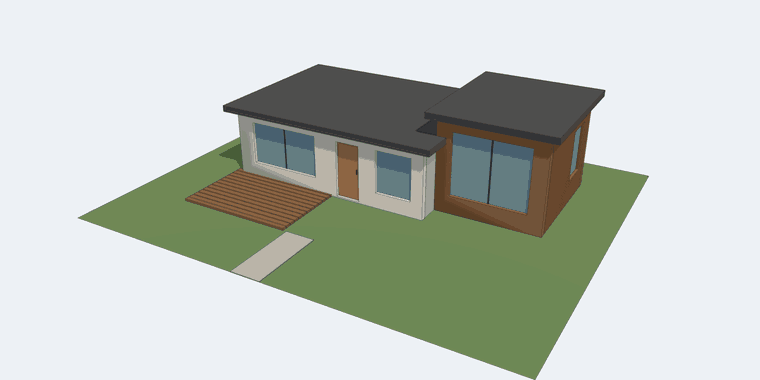

# OpenSKP

**The open-source SketchUp (`.skp`) file parser, writer, and converter — C++17 edition.**

Parse, write, and convert `.skp` files without SketchUp. No SDK. No license. Just code.

[](https://opensource.org/licenses/MIT)
[](https://github.com/iamahsanmehmood/openskp/releases?q=cpp-)

🏠 [openskp.com](https://openskp.com) · 🌐 [Try the Live Web Viewer](https://iamahsanmehmood.github.io/openskp/) · 📖 [Docs](https://iamahsanmehmood.github.io/openskp/docs/) · [Changelog](https://github.com/iamahsanmehmood/openskp/blob/main/CHANGELOG.md)



Questions and ideas are welcome in [Discussions](https://github.com/iamahsanmehmood/openskp/discussions). If OpenSKP is useful to you, a [star on GitHub](https://github.com/iamahsanmehmood/openskp) helps others find it.

> [!IMPORTANT]
> This project was built by reverse engineering a proprietary binary format. It is not affiliated with or endorsed by Trimble Inc. or SketchUp.

## What is OpenSKP?

OpenSKP is an open-source, cross-platform parser for
SketchUp binary files — reverse-engineered from both the modern **VFF
container** (SketchUp 2021+) and the classic **MFC `CArchive`** container
(SketchUp 4–2020; see [version support](https://github.com/iamahsanmehmood/openskp/blob/main/docs/LANGUAGE_PARITY.md#4-real-sketchup-file-version-support)). It gives you full programmatic access to geometry,
materials, components, layers, and metadata, with no SketchUp installation
and no proprietary SDK required. The same parser and export API also ship
as first-class packages for Python, TypeScript, .NET, and Dart — see the
[project README](https://github.com/iamahsanmehmood/openskp) for the full
cross-language picture.

This package can also *write* new `.skp` files from scratch, and edit
existing ones, checked against SketchUp's C library via
`tools/check_native_skp.py` (see [Writing](#writing) below and
[Writer validation](https://github.com/iamahsanmehmood/openskp/blob/main/docs/LANGUAGE_PARITY.md#writer-validation)).

## Features

- **Full-fidelity parsing** — vertices, edges, faces, normals, UV
  coordinates, nested component hierarchies, layers/tags, materials,
  textures, styles, and dynamic-component attributes.
- **Both SketchUp file generations** — modern VFF (2021+) and classic MFC
  (SketchUp 4–2020) containers, transparently, behind one `parse()` call.
- **Scene baking** — an opt-in `build_scene()` pass resolves the full
  placed scene graph to world-space, triangulated, export-ready geometry.
- **Native multi-format conversion** — glTF (GLB), Wavefront OBJ/MTL, STL,
  PLY, AutoCAD DXF (3DFACE and Polyface Mesh), IFC4 (BIM/ISO 10303-21
  STEP), and JSON — no third-party CAD/BIM SDK involved beyond the three
  privately-bundled dependencies below (miniz for ZIP, TinyGLTF for GLB,
  FlatBuffers for Fragments).
  The DXF writer is verified against real desktop AutoCAD, not just
  lenient DXF readers.
- **Write support** — build new legacy-format `.skp` files from scratch:
  geometry (including true, editable circular/arc curves, freeform
  polylines, faces with holes cut out, and non-planar auto-triangulation),
  materials (solid + PNG/JPEG textures), layers, nested component
  definitions and groups, instance rotation/visibility, and custom
  attribute dictionaries — or load and extend an existing file with
  `openskp::open_existing()`. No SDK at runtime; checked against SketchUp's C
  library via `tools/check_native_skp.py` (see
  [Writer validation](https://github.com/iamahsanmehmood/openskp/blob/main/docs/LANGUAGE_PARITY.md#writer-validation)
  and [Writing](#writing) below).

## Dependencies

Building OpenSKP requires:

- CMake 3.21 or newer.
- A C++17 compiler and standard library, plus a C compiler for the bundled
  miniz sources. GCC, Clang, and MSVC are supported.
- Git and network access during the first CMake configure, unless the
  FetchContent dependencies have been provided locally.

CMake fetches these pinned dependencies:

| Dependency | Version | Used for | Required when |
| --- | --- | --- | --- |
| [miniz](https://github.com/richgel999/miniz) | 3.1.2 (`77d0dce8627735138c51770d1799a1ef48f2117d`) | Reading modern SKP ZIP containers | Always |
| [TinyGLTF](https://github.com/syoyo/tinygltf) | 2.9.7 (`488a70a3df62a4df1a736e9e56fb8836580c4888`) | Writing binary glTF 2.0 assets | Always |
| [FlatBuffers](https://github.com/google/flatbuffers) | 25.12.19 (headers only) | Reading and writing Fragments (`.frag`) | Always |
| [GoogleTest](https://github.com/google/googletest) | 1.17.0 (`52eb8108c5bdec04579160ae17225d66034bd723`) | C++ test suite | `OPENSKP_BUILD_TESTS=ON` |

miniz, TinyGLTF and FlatBuffers are compiled privately into OpenSKP, and GoogleTest is used
only by the test executable. None is a transitive dependency for installed consumers.
The triangulation implementation is included in this source tree and does not
require a separate library.

Standard FetchContent source overrides and offline workflows are supported,
including `FETCHCONTENT_SOURCE_DIR_MINIZ`,
`FETCHCONTENT_SOURCE_DIR_TINYGLTF`, `FETCHCONTENT_SOURCE_DIR_FLATBUFFERS` and
`FETCHCONTENT_SOURCE_DIR_GOOGLETEST`.

clang-format is an optional developer dependency. Version 18 is the canonical
CI version; it is needed only for the formatting targets documented below.

## Build and install

```bash
cmake -S . -B build -DOPENSKP_BUILD_TESTS=ON
cmake --build build
ctest --test-dir build --output-on-failure
cmake --install build --prefix /your/prefix
```

Consumers use the installed config package:

```cmake
find_package(OpenSkp CONFIG REQUIRED)
target_link_libraries(my_app PRIVATE OpenSkp::OpenSkp)
```

```cpp
#include <openskp/openskp.hpp>

auto file = openskp::SkpFile::open("model.skp");
auto model = file.parse();
auto scene = file.build_scene(); // independent reparse

// GLB export
auto bytes = openskp::to_glb(scene);
openskp::export_glb(scene, "model.glb");

// Wavefront OBJ export, plus a companion .mtl material library
auto obj_text = openskp::to_obj(scene, "model.mtl");
auto mtl_text = openskp::to_mtl(scene);
openskp::export_obj(scene, "model.obj"); // writes .obj + .mtl together

// STL export (3D printing), ASCII or little-endian binary
auto stl_bytes = openskp::to_stl_binary(scene);
openskp::export_stl(scene, "model.stl", /*binary=*/true);

// PLY export (Stanford Triangle Format), ASCII or little-endian binary
auto ply_bytes = openskp::to_ply_binary(scene);
openskp::export_ply(scene, "model.ply", /*binary=*/true);

// DXF export (AutoCAD R2000 compliant, Polyface Mesh by default)
auto dxf_str = openskp::to_dxf(scene);
openskp::export_dxf(scene, "model.dxf");

// IFC4 / BIM export (ISO 10303-21 STEP format)
auto ifc_str = openskp::to_ifc(scene);
openskp::export_ifc(scene, "model.ifc");
```

STL contains only the front winding of each SketchUp face, including faces
painted differently on each side; STL does not carry colour. GLB and the
colour-capable OBJ, PLY, DXF, IFC and Fragments exports retain separately
painted sides.

`to_glb()` returns the complete binary asset as a `ByteBuffer`.
`export_glb()` writes those bytes to disk. Metadata JSON export is provided
via `to_json(model, &scene)`, which returns a `JsonValue` tree — pass it to
`to_json_string(value, indent)` for actual JSON text, or use
`export_json(model, path, &scene)` to write a file directly (note: `path`
comes before `scene` in that signature).

`BUILD_SHARED_LIBS` controls static/shared output (static is the CMake
default). `OPENSKP_BUILD_TESTS` defaults on only when this directory is the
top-level project, and `OPENSKP_BUILD_EXAMPLES` defaults off.
When examples are enabled, `openskp_export_glb input.skp output.glb` provides
a small command-line export example.

## Writing

OpenSKP can also *create* new `.skp` files from scratch — a genuine,
from-scratch binary writer that emits a **SketchUp 2017 (`{17.0.1}`)** classic
MFC `CArchive` file (spliced into a bundled blank-document scaffold, readable in
SketchUp 2017+), with no SketchUp SDK involved at any point. Ports the same
feature set as the Python package's writer: geometry (including true,
editable circular/arc curves, freeform polylines, faces with holes cut
out, and non-planar auto-triangulation), materials (solid + PNG/JPEG
textures), layers (with color, default visibility, and named extra
dictionaries), component
definitions with multiple instances, groups, nested definitions and
nested group instances, per-instance rotation and visibility, explicit
per-side texture positioning, and custom key/value attribute
dictionaries. Checked against SketchUp's C library via
`tools/check_native_skp.py` and diffed against the Python and Rust writers in
CI (see [Writer validation](https://github.com/iamahsanmehmood/openskp/blob/main/docs/LANGUAGE_PARITY.md#writer-validation)
for the persistent-ID, file-GUID, and textured-material alpha differences
relative to Python), plus its own full test suite passing in CI across GCC,
Clang, and MSVC.
Each new builder now has a distinct file/model GUID, stable across repeated writes.
Use `builder->set_guid("00112233-4455-4677-8899-aabbccddeeff")` to preserve a known
model identity, and set `DefinitionOptions::guid` when recreating an existing
component. Both accept 32 hexadecimal digits or the hyphenated UUID form; empty
means a new identity, and malformed non-empty input throws `SkpWriteError`.
Reuse an identity only for the same unchanged component; names or identical
geometry alone do not establish identity.

**Behavior change:** classic and VFF readers now return canonical UUID byte order
(uppercase, without hyphens) for definition GUIDs and instance GUID references,
instead of exposing Windows GUID storage order. Consumers that persisted old
raw-order strings should migrate or normalize them before comparing identities.
The same component now retains the same GUID across classic and VFF containers.

For VFF files, `Definition::parsed_dictionaries` exposes the definition's own
attribute dictionaries with native value types, including booleans, integers,
`nil`, and nested arrays. Attributes on child instances stay on those instances.
The new field is empty for legacy files.

`openskp::open_existing()` loads an *existing* legacy-format file and
rebuilds it as a new builder, so more geometry can be added before
saving. See [`include/openskp/create.hpp`](include/openskp/create.hpp)
for the full scope notes.

```cpp
#include <openskp/openskp.hpp>

using namespace openskp;

auto builder = create();

// Materials and layers
int red = builder->add_material("Red", Color3{255, 0, 0});
LayerOptions roof_opts;
roof_opts.color = Color4{180, 60, 40, 255};
int roof = builder->add_layer("Roof", roof_opts);

// All add_component_definition/add_group calls must come before any
// add_instance/add_face call - placing anything locks in the file's
// internal slot numbering for everything after it
auto& chair = builder->add_component_definition("Chair");
chair.add_face({{0, 0, 0}, {20, 0, 0}, {20, 20, 0}, {0, 20, 0}});
chair.close();

InstanceOptions first_chair_opts;
first_chair_opts.translation = {50, 0, 0};
builder->add_instance(chair, first_chair_opts);

InstanceOptions second_chair_opts;
second_chair_opts.translation = {100, 0, 0};
second_chair_opts.hidden = true;
builder->add_instance(chair, second_chair_opts);

FaceOptions roof_face_opts;
roof_face_opts.material = red;
roof_face_opts.layer = roof;
builder->add_face({{0, 0, 0}, {100, 0, 0}, {100, 100, 0}, {0, 100, 0}}, roof_face_opts);

builder->save("output.skp");
```

### Editing an existing file

```cpp
#include <iostream>
#include <openskp/openskp.hpp>

using namespace openskp;

OpenExistingResult result = open_existing("building.skp");
for (const auto& w : result.warnings) std::cerr << "not fully reproduced: " << w << '\n';

result.builder->add_circle({0, 0, 100}, {0, 0, 1}, 50.0);
result.builder->save("building_edited.skp");
```

`result.warnings` is the honest account of what couldn't be faithfully
reproduced from that specific source file. Every material/layer the
source had is reachable on `result.builder->materials_by_name`/
`layers_by_name` without a separate lookup, and `result.definitions` maps
each replayed component definition's own name to its builder for placing
more instances of something the source already defined.

### Generating code from a file

`to_cpp_code()` takes the opposite approach: instead of a builder you
keep editing, it returns a **string of source code** — a re-runnable
transcript of `create()` calls that rebuilds an equivalent file when run:

```cpp
#include <iostream>
#include <openskp/openskp.hpp>

using namespace openskp;

SkpModel model = SkpFile::open("building.skp").parse();
std::cout << to_cpp_code(model);
```

Useful for handing a real model to an AI coding agent as editable
starting code, or for a diffable, reviewable text representation of a
`.skp` file. Shares the same fidelity scope as `openskp::open_existing()`
above.

## Formatting

C++ sources use the Google clang-format style with a 100-column limit.
clang-format 18 is the canonical CI version. Data members in structs and
classes use separate declarations: declare one member per line, even when
adjacent members have the same type.

```bash
cmake --build build --target openskp-format
cmake --build build --target openskp-format-check
```

If CMake does not find the desired executable automatically, configure with
`-DOPENSKP_CLANG_FORMAT_EXECUTABLE=/path/to/clang-format`.

## Used in Production

OpenSKP powers the SketchUp import pipeline for
[FrameSmart](https://frame-smart.com/) (a 3D collaboration platform) and
[IngeTrazo](https://ingetrazo.com/) (a
SketchUp-alternative 3D modeler with a BIM → IFC bridge). Using OpenSKP in
your own project? [Open an issue](https://github.com/iamahsanmehmood/openskp/issues)
or a PR to get added here.

## License

MIT — see the [root repository](https://github.com/iamahsanmehmood/openskp) for
full documentation and multi-language packages.

### Native v17 display settings and compatibility

`SkpBuilder::set_document_options(DocumentOptions)` sets decimal length units and
precision without rescaling geometry (coordinates remain inches). `length_unit`
uses SketchUp values: 0 inches, 1 feet, 2 millimeters, 3 centimeters, 4 meters,
5 yards. `length_precision` ranges from 0 to 6. Defaults are unchanged unless
this method is called.

`style_items` maps native style item IDs to scalar values. Colors use packed
ABGR integers; booleans use 0 or 1. For example, `{{4000, 0xff563412u},
{1006, 0}, {1007, 5}}` sets background RGB(18,52,86), disables profile edges,
and sets profile width to 5. Supported fields update current rendering options
and the scaffold's saved and working styles. Items absent from the fixed v17
scaffold are ignored. This does not add scene, watermark-image, or modern SKP
compression support. These display-setting additions are currently C++ only.

Native compatibility tests inspect serialized face equations and persistent IDs,
not only OpenSKP self round-trips. Face planes use `ax+by+cz+d=0`; persistent IDs
are document-wide and the next-ID header is 64-bit. Nonplanar fan triangulation
skips degenerate wedges before writing any valid triangles. Legacy textured
materials store image-average and paint colors separately, followed by material
type (1 textured / 2 colorized) and colorize mode (0 shift / 1 tint); image alpha
is not a colorization flag. Other language implementations may need matching
corrections to these fields. No proprietary SDK is needed at runtime or in CI.

For optional independent validation with your own locally installed SketchUp C API:

```sh
python3 packages/cpp/tools/check_native_skp.py generated.skp \
  --library /path/to/SketchUpAPI --unit mm --precision 2 \
  --background 18,52,86 --textured-material paint --resave new-modern.skp
```

The checker validates native units, background, group definition types and named
texture dimensions. `--resave` exercises the SDK's modern-format serialization,
which can expose persistent-ID conflicts that a self round-trip misses. The SDK
is optional and is neither downloaded nor redistributed by this project.
